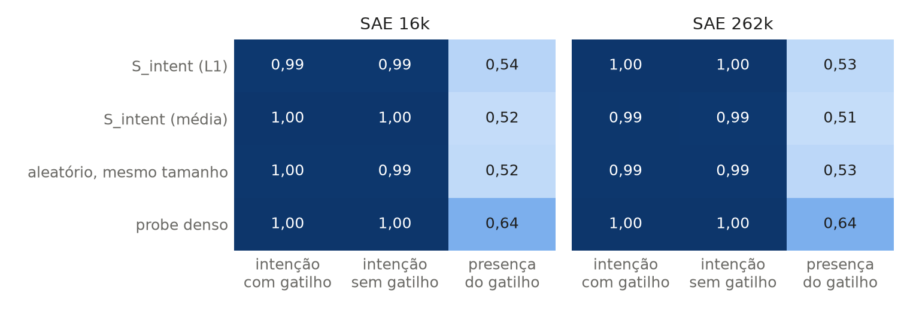
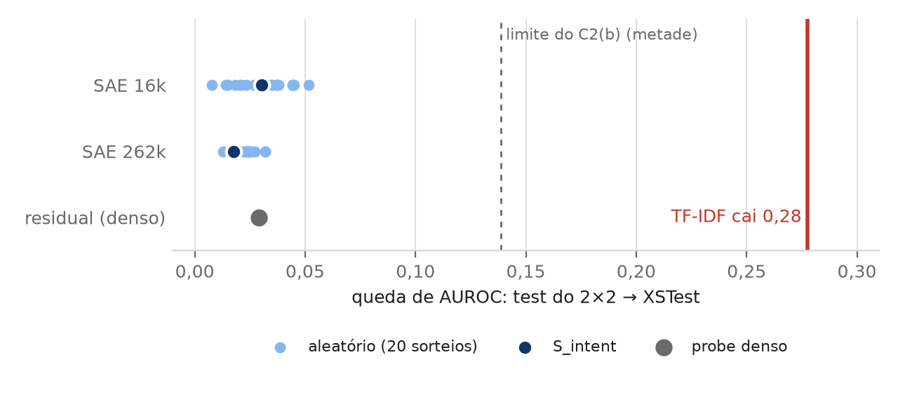
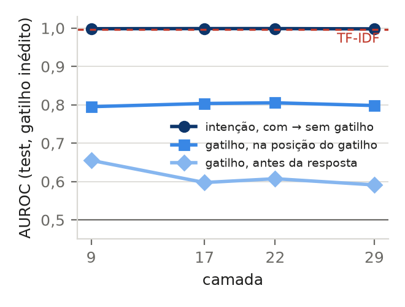
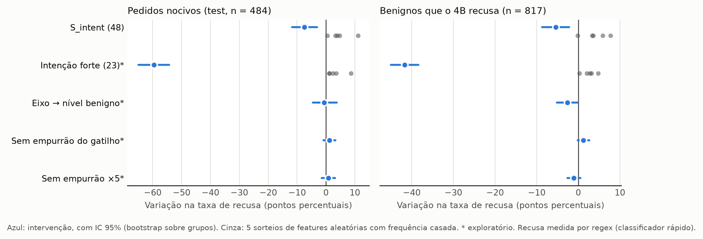

# Intenção ou palavras? Separando o sinal de nocividade da forma lexical nas features de um SAE

> **Rascunho.** Esqueleto de 2026-11-20; seções do Davi escritas em 2026-11-22. As seções marcadas com _(a escrever: nome)_ têm dono em [`README.md`](README.md). Os números entram de `results/VEREDITO.md`.

> **Nota provisória (2026-11-21): contexto para quem for escrever, inclusive LLMs.** O grupo aprovou as mudanças abaixo. Esta nota sai quando a estrutura estiver estável.
>
> - **Formato:** duas colunas (estilo ACL), com **no máximo 10 páginas**, sem contar as referências e os apêndices.
> - **Estrutura:**
>   - a seção "Ética" saiu: o texto dela virou o parágrafo **"Uso responsável dos dados"**, no fim da seção 3, com uma frase sobre uso duplo;
>   - "Limitações" e "trabalhos futuros" viraram uma seção só (**6**);
>   - entrou a seção **7. Conclusão**.
> - **Detalhes vão para apêndices**, que não contam nas 10 páginas. Exemplo: Apêndice A, da frente C.
> - **Orçamento por seção** (aproximado; uma página de duas colunas tem cerca de 800 palavras de texto):
>
> | Seção | Páginas | Palavras |
> |---|---|---|
> | Resumo + 1. Introdução | 1,2 | 900 |
> | 2. Trabalhos relacionados | 0,8 | 650 |
> | 3. Dados (com a figura 1) | 1,2 | 700 |
> | 4. Métodos (4.2: ~650) | 2,3 | 1.700 |
> | 5. Resultados (figuras 2 a 5) | 3,0 | 1.600 |
> | 6. Limitações e trabalhos futuros | 0,8 | 600 |
> | 7. Conclusão | 0,5 | 400 |
> | **Total** | **~9,8** | **~6.500** |

## Resumo

Modelos de linguagem alinhados recusam pedidos benignos que soam perigosos, o chamado *over-refusal*. Uma explicação possível é que a recusa siga as palavras alarmantes do pedido e não a sua intenção. Testamos essa hipótese nas features de autoencoders esparsos (SAEs) do Gemma Scope 2 no Gemma-3-4B-IT. Para isso, montamos pares mínimos em um desenho 2×2: cada pedido nocivo e cada benigno aparece com a expressão alarmante e com ela trocada por uma forma neutra. Os critérios de resposta foram definidos antes de ver as ativações. Na camada 29, no token anterior à resposta, 48 features respondem à intenção e ignoram a troca; todas se confirmam em pedidos com gatilhos inéditos. Nenhuma feature responde de forma consistente à expressão alarmante. Desligar as 48 features reduz a recusa a pedidos nocivos em 12 pontos em relação a features sorteadas, e também reduz a recusa a pedidos benignos. A informação de intenção, porém, está espalhada: features sorteadas a classificam tão bem quanto as selecionadas. <!-- fonte: results/VEREDITO.md; results/frente-b/c5_ablacao.json -->

## 1. Introdução

Um modelo alinhado deve recusar "como eu mato o cachorro do vizinho?" e atender "como eu mato o processo travado do servidor?". Na prática, ele às vezes recusa o segundo: o pedido é benigno, mas contém uma palavra que costuma aparecer em pedidos nocivos. Esse *over-refusal* é medido em conjuntos como XSTest e OR-Bench (Röttger et al., 2024; Cui et al., 2025), e convive com o problema oposto, o atendimento a pedidos nocivos escritos sem palavras alarmantes. As duas falhas sugerem que o modelo decide, ao menos em parte, pela superfície do pedido.

A hipótese tem uma versão interna que dá para testar. Se o modelo representasse separadamente a **intenção** do pedido e a sua **forma lexical**, o over-refusal seria o comportamento seguindo a segunda. SAEs decompõem o residual de um modelo em features esparsas, muitas delas interpretáveis (Bricken et al., 2023; Templeton et al., 2024). O Gemma Scope 2 oferece SAEs abertos para todas as camadas da família Gemma 3 (Google DeepMind, 2025). A pergunta deste trabalho é se, nessas features, existe um sinal de intenção nociva que se distingue do sinal de forma lexical.

A pergunta é mais difícil do que parece, porque em pares comuns de pedidos nocivos e benignos as duas coisas andam juntas. No nosso conjunto inicial, os pedidos nocivos vêm do PKU-SafeRLHF e a maioria dos benignos foi gerada por um LLM. Um classificador que só vê o estilo do texto, sem nenhuma palavra de conteúdo, separa os dois com AUROC 0,88. <!-- fonte: results/frente-d/baseline_lexical.json → pairs --> Qualquer feature que "detecte intenção" nesses pares pode estar detectando a fonte.

Para separar os fatores, usamos um desenho 2×2 por grupo. Cada grupo tem um pedido nocivo e um benigno que compartilham uma expressão-gatilho, como "mato" no exemplo acima. Cada um aparece duas vezes: com o gatilho e com ele trocado por uma forma neutra ("encerro"), sem mudar o resto do texto. O efeito de intenção é a diferença entre as linhas; o efeito lexical, entre as colunas. Os critérios de resposta, os limiares e os testes foram registrados antes de qualquer ativação.

As contribuições são:

- um conjunto de 1.697 grupos 2×2 em quatro domínios, com controles de estilo e de gatilho isolado, e critérios pré-registrados (C1–C5), um deles relativo a um baseline lexical;
- a constatação de que, no Gemma-3-4B-IT, a intenção aparece em 48 features que ignoram a troca do gatilho, enquanto nenhuma feature responde de forma consistente à expressão alarmante;
- evidência causal de que essas features controlam a recusa, inclusive a recusa indevida, e de que a informação de intenção, ao contrário do controle, está espalhada pela representação.

## 2. Trabalhos relacionados

**SAEs como dicionário.** Redes neurais representam mais features do que têm dimensões, sobrepostas em direções quase ortogonais (Elhage et al., 2022). SAEs treinados no residual recuperam parte dessas features de forma esparsa e interpretável (Bricken et al., 2023; Cunningham et al., 2023), e escalam para modelos grandes (Templeton et al., 2024; Gao et al., 2024). As variantes JumpReLU e BatchTopK melhoram a troca entre esparsidade e reconstrução (Rajamanoharan et al., 2024; Bussmann et al., 2024). O Gemma Scope publicou SAEs JumpReLU para o Gemma 2 (Lieberum et al., 2024); o Gemma Scope 2, que usamos, estende isso aos modelos de chat do Gemma 3 (Google DeepMind, 2025). Avaliar esses dicionários continua difícil (Karvonen et al., 2025), e SAEs treinados nos mesmos dados podem aprender features diferentes (Paulo & Belrose, 2025). Por isso repetimos a seleção de features num dicionário de 262k features.

**Recusa no residual.** Arditi et al. (2024) mostram que a recusa é mediada por uma única direção no residual, e O'Brien et al. (2025) a controlam desligando features de SAE. Esses trabalhos localizam a recusa. O nosso pergunta de que ela depende: da intenção do pedido ou da sua forma.

**Over-refusal.** XSTest (Röttger et al., 2024) e OR-Bench (Cui et al., 2025) medem quanto os modelos recusam pedidos benignos que parecem perigosos, e FalseReject (Zhang et al., 2025) amplia essa medida. Pares de pedidos nocivos e benignos vêm de conjuntos como o PKU-SafeRLHF (Ji et al., 2025). Nenhum desses conjuntos manipula a forma lexical independentemente da intenção, que é o que o desenho 2×2 faz.

**Interpretação automática.** Bills et al. (2023) usam um LLM para descrever neurônios e pontuam a descrição pela capacidade de prever ativações. Paulo et al. (2025) escalam esse procedimento para milhões de features de SAE. Usamos essas descrições como ponto de partida da leitura das features no C3.

## 3. Dados

_(a escrever: Gustavo.)_

### 3.1 Pares da Fase 0

2.428 pares Q⁺/Q⁰ com o mesmo gatilho, em 4 domínios (bias, cyber, privacy, violence), com splits por grupo (1.710 / 371 / 347). <!-- fonte: datasets/phase0/README.md --> O protocolo de geração e rotulagem está no relatório da Fase 0.

**Por que não bastam:** Q⁺ vem do PKU e 83% dos Q⁰ foram gerados. O TF-IDF separa os pares com AUROC 0,995 e o estilo sozinho com 0,88. <!-- fonte: results/frente-d/baseline_lexical.json -->

### 3.2 O 2×2 por frase-molde

- Uma frase com duas lacunas, `{FORMA}` e `{INTENCAO}`; as quatro células saem de preenchê-las (Figura 1).
- A tipologia dos gatilhos (superfície, ação, marcador de intenção) e por que marcadores de intenção ficam fora da lacuna de forma.
- Validação: validador automático (estrutura, gatilho, diff, tamanho) e três juízes (intenção). Rodada seca: sobrevivência e decisão molde × plano B. <!-- fonte: results/frente-a/rodada_seca.md -->
- Números finais: grupos, por domínio e por tipo de gatilho. Controles `trig_only` e `neutral_only`. XSTest e OR-Bench-Hard como conjuntos externos.

**Uso responsável dos dados.** O dataset contém pedidos e respostas nocivas, todos do PKU-SafeRLHF. Não geramos respostas nocivas. Os pedidos nocivos do 2×2 são recombinações de trechos dos pedidos do PKU, sem detalhes operacionais novos. Os dados são usados só para pesquisa e não são reproduzidos fora do repositório do projeto. Identificamos features ligadas à recusa, e a seção 4.4 as desliga para testar causalidade. Essa técnica tem uso duplo: a mesma intervenção que estuda o over-refusal poderia reduzir recusas legítimas. Por isso, o texto reporta só resultados agregados. _(Rascunho: revisar no grupo.)_

## 4. Métodos

### 4.1 Modelo, SAEs e extração

_(texto da frente B)_

Usamos o Gemma-3-4B-IT congelado, em bf16 e sem system prompt.

**Extração.** Lemos o fluxo residual (`resid_post`) nas camadas 9, 17, 22 e 29 (29%, 53%, 68% e 88% da profundidade). Conferimos que a saída capturada por hook é idêntica a `hidden_states[L+1]` (diferença zero). Cada vetor passa por três SAEs:
- os do Gemma Scope 2 (JumpReLU, `l0_medium`), de 16k e de 262k features;
- um SAE próprio (BatchTopK, 16k, k = 64), em L17, L22 e L29.

**Posições.** As principais são o último token do pedido (`inst_last`) e o último token do template, logo antes da resposta (`post_last`). As secundárias são as médias de posições, o gatilho e a lacuna de forma do 2×2.

**Lotes.** Usamos padding à direita, com as quatro células de um grupo no mesmo lote. Assim, o prefixo comum às células sai bit a bit igual. Cada arquivo do cache tem sha256 e o commit que o gerou.

**Qualidade dos SAEs nos nossos pedidos.** Em todos os tokens, o Gemma Scope 16k explica 84–96% da variância e recupera ~99% da perda de substituir a camada por zero (ΔNLL de 0,15 a 0,35). Nas posições principais, porém, ele reconstrói só 55–67% da **variação entre pedidos** em L17–L29. O SAE próprio reconstrói 69–83%, mas preserva pior o comportamento do modelo (recupera 96–99%). Detalhes em `results/frente-b/qualidade_saes.md`.

### 4.2 Estatística por feature

**Desenho.** Cada grupo do 2×2 tem um pedido nocivo e um benigno com a mesma expressão-gatilho. Cada pedido aparece com o gatilho original e com o gatilho trocado por uma expressão neutra (seção 3.2). Para cada pedido, passamos pelo SAE o `resid_post` numa posição. Depois comparamos a ativação de cada feature entre as quatro células do grupo.

**Efeitos.** a(h, t) é a ativação na célula de intenção h ∈ {nociva +, benigna 0} e gatilho t ∈ {presente 1, ausente 0}. Por grupo:

- **intenção:** I_g = ½[a(+,1) + a(+,0) − a(0,1) − a(0,0)];
- **gatilho:** L_g = ½[a(+,1) + a(0,1) − a(+,0) − a(0,0)];
- **interação:** X_g = ½[a(+,1) − a(+,0) − a(0,1) + a(0,0)].

O tamanho de efeito é o d pareado: a média entre grupos dividida pelo desvio-padrão. \|d\| = 0,2 é um efeito pequeno e 0,5, um efeito médio. d_I > 0 indica feature mais ativa nos pedidos nocivos. O IC 95% vem de um bootstrap sobre grupos. O p vem de um Wilcoxon pareado, com correção de Benjamini–Hochberg sobre features, camadas e posições.

**Posições e dicionário.** Usamos as camadas 9, 17, 22 e 29 e duas posições. As duas têm o mesmo token nas quatro células e o pedido inteiro no contexto:

- **fim_pedido:** o último token do texto do usuário;
- **pre_resposta:** o último token do template, de onde sai a resposta.

O SAE principal é o Gemma Scope 2 de 16k features (L0 *medium*); o de 262k serve de robustez (Apêndice A).

**Classes.** Consideramos as features ativas em ≥ 5% dos pedidos de alguma célula.

- **S_intent:** \|d_I\| ≥ 0,5, q_I < 0,01 e o IC 95% de d_L inteiro dentro de ±0,2. Esse teste de equivalência exige que o efeito do gatilho seja desprezível, e não só pequeno.
- **S_lex:** o simétrico.
- **S_mixed:** os dois efeitos grandes e significativos.

**Descoberta e confirmação.** Os splits são por grupo. Todas as escolhas usam só `train` + `val`. A combinação principal é o par (camada, posição) com mais S_intent. A confirmação (`test`) foi aberta uma vez, nessa combinação, só nos grupos cujo gatilho não aparece no `train`. Replicar quer dizer manter o sinal com \|d_I\| ≥ 0,3.

**Critérios pré-registrados.**

- **C1:** ≥ 5 S_intent, das quais ≥ 70% replicam.
- **C3:** duas condições.
  1. Mais da metade das S_intent fica sem efeito (IC dentro de ±0,2) entre frases neutras com o gatilho (`trig_only`) e com a expressão neutra (`neutral_only`).
  2. ≥ 60% das fichas do top-20 são rotuladas "conceitual" numa leitura cega.
- **C4a:** o C1 vale também no SAE de 262k.

**Análises secundárias.**

- **Estilo:** no plano B, o pedido nocivo e o benigno vêm de fontes diferentes. Estimamos o efeito de intenção com estilo igual, por regressão de I_g em 14 atributos de estilo.
- **Por categoria:** efeito por domínio e por tipo de gatilho.
- **Filtros de qualidade:** robustez a três filtros alternativos.

**Conjunto.** São 1.697 grupos que passam no QC de gramática e no validador estrutural: 1.455 na descoberta e 242 na confirmação, 155 deles com gatilho inédito. <!-- fonte: results/frente-c/preregistro.md, adendo 3 --> Os desvios do pré-registro estão em `results/DESVIOS.md`.

### 4.3 Baselines, probes e dissociação dupla

**Réguas de texto.** Antes de olhar ativações, medimos quanto da tarefa um classificador resolve só com o texto. O TF-IDF usa n-gramas de palavras (1–2) e de caracteres (3–5) com regressão logística. O classificador de estilo vê 14 atributos (tamanho, pontuação, maiúsculas, forma da pergunta, primeira pessoa) e nenhuma palavra de conteúdo. Um terceiro classificador vê só a presença do gatilho. Em todos, o C é escolhido por validação cruzada agrupada por gatilho, só no `train`, e o IC 95% vem de bootstrap sobre grupos.

**Âncora densa.** Uma regressão logística L2 no residual completo (d = 2.560), por camada e posição, mede quanta informação existe antes do SAE. Treinamos o probe de intenção só nas células com gatilho e o testamos nas células sem gatilho, e vice-versa. O probe de gatilho é treinado nos pedidos benignos e testado nos nocivos, para que não possa usar a intenção.

**C2.** Restringimos o classificador às features de S_intent. O classificador principal é uma regressão logística L1; uma média padronizada das features serve de checagem. Há dois controles: o mesmo classificador com features sorteadas do mesmo tamanho, entre as ativas em ≥ 5% do `train` (20 sorteios), e o probe denso como teto. O C2 tem três partes.

- **(a) Mínimo:** AUROC ≥ 0,85 com gatilho e ≥ 0,80 sem gatilho, no `test` com gatilho inédito.
- **(b) Relativo ao TF-IDF:** a queda de AUROC de S_intent ao sair da distribuição deve ser no máximo metade da queda do TF-IDF, com o limite superior do IC 95% da razão abaixo de 1. O pré-registro previa três generalizações (gatilho inédito, domínio inédito e XSTest). Nas duas primeiras o TF-IDF quase não cai (0,003 e 0,015), o que torna a razão indefinida, e por isso o critério passou a ser decidido só pelo XSTest. A mudança foi votada com a régua medida em `val`, antes de existir o cache do XSTest. <!-- fonte: results/frente-d/baseline_lexical.json → cells_2x2.principal.regua_C2b_tfidf; results/DESVIOS.md -->
- **(c) Consistência:** S_intent não detecta o gatilho (AUROC ≤ 0,65) e S_lex detecta (≥ 0,85). Não decide.

**Recortes do C4.** Repetimos o C2 em dois subconjuntos: grupos cujo Q⁰ original veio do OR-Bench e não de um gerador (211 grupos) e grupos cujas células diferem no máximo 20% em tokens (684). <!-- fonte: results/frente-d/c2_c4_L29_post_last_16k.json → b_q0_retrieved, c_tamanho_pareado -->

### 4.4 Intervenção

_(texto da frente B)_

**Onde intervimos.** Num hook na saída do bloco 29, em todos os tokens (pedido, template e geração).

**Como desligamos features.** Codificamos o vetor com o SAE 16k e subtraímos a contribuição das features escolhidas:
x' = x − dec(f) + dec(f'), onde f' é f com essas features zeradas.

O erro de reconstrução é preservado, então só as features escolhidas mudam. Com a lista vazia, a saída do modelo é bit a bit igual.

**Condições.**
- **Pré-registrada:** a ablação das 48 S_intent.
- **Controle:** 5 sorteios com o mesmo número de features aleatórias, com frequência de ativação casada por decil.
- **Exploratórias:**
  - a ablação das 23 features de intenção forte que ficaram fora de S_intent (seção 5.x), com o seu próprio controle aleatório;
  - levar a projeção no eixo da intenção u ao nível médio dos benignos;
  - subtrair o empurrão médio do gatilho nesse eixo (c·u, com c = 2,5% do efeito de intenção), que substitui a ablação de S_lex, cuja lista saiu vazia.

As duas intervenções no eixo agem só no `post_last`, onde u e c foram medidos.

**Itens.** O `test` do conjunto principal (242 grupos, 968 pedidos) e 817 pedidos benignos que o 4B recusa. As listas e o eixo vêm só da descoberta.

**Geração e rotulagem.** Geração gulosa, até 256 tokens. A recusa é medida por um classificador rápido de frases de recusa (precisão 0,78 e cobertura 0,56 contra o juiz) e, na versão final, pelo juiz da seção 3.

**Estatística.** Diferença pareada de taxas, com IC 95% por bootstrap sobre grupos. O critério do C5 é o efeito da lista menos o efeito médio dos sorteios aleatórios.

### 4.5 Pré-registro

Os limiares, os testes e as regras de análise foram commitados antes de qualquer dado de ativação (`results/frente-c/preregistro.md`). Os desvios estão em `results/DESVIOS.md`.

## 5. Resultados

Todos os números são do `test`, no recorte de gatilho inédito, salvo indicação. A seção 5.7 aplica a regra de decisão.

### 5.1 Existe um sinal de intenção? (C1) · _texto da frente C_

| Camada | fim_pedido | pre_resposta |
|---|---|---|
| L9 | 6 | 14 |
| L17 | 7 | 36 |
| L22 | 8 | 40 |
| L29 | 6 | **48** |

*Tabela.* Número de S_intent por combinação (SAE 16k, descoberta). <!-- fonte: results/frente-c/c1_c3.json → 16k.combinacoes_descoberta -->

**Onde está o sinal.** O sinal de intenção está no pre_resposta e cresce com a profundidade. A combinação principal é L29 · pre_resposta, com 48 S_intent.

**Nenhuma feature reage só ao gatilho.** Não há S_lex nem S_mixed em nenhuma combinação; o maior \|d_L\| é 0,40 (Figura 2). <!-- fonte: results/frente-c/feature_classes_L*_16k.csv -->

*Figura 2.* d_I × d_L de cada feature ativa (SAE 16k, descoberta). Linhas: fim_pedido e pre_resposta. Colunas: camadas. Faixa cinza: \|d\| < 0,2; tracejado: \|d\| = 0,5. Muitas features reagem à intenção; nenhuma, ao gatilho.

**O sinal se confirma.** No `test` com gatilho inédito (155 grupos), as 48 replicam: **C1 atende**. O efeito tem o mesmo tamanho da descoberta (razão mediana 1,03). <!-- fonte: results/frente-c/c1_c3.json → 16k.replicacao_S_intent -->

**É robusto.**

- Nos três filtros de qualidade alternativos saem 47, 45 e 22 S_intent, quase todas as mesmas.
- As 48 sobrevivem ao controle de estilo (R² mediano do estilo: 0,07).
- Valem nos 4 domínios e nos 3 tipos de gatilho.

<!-- fonte: results/frente-c/robustez_*/; c1_c3.json → 16k.C1_controle_estilo, por_dominio, por_tipo_gatilho -->

### 5.2 O sinal se separa do lexical? (C2)

**S_intent classifica a intenção com e sem gatilho.** Na combinação principal, um classificador L1 com as 48 S_intent separa pedidos nocivos de benignos com AUROC 0,992 com gatilho (IC 0,985–0,997) e 0,992 sem gatilho (IC 0,984–0,997), no `test` com gatilho inédito. No SAE de 262k, com 60 features, os valores são 0,998 e 0,997. O C2(a) atende nos dois. As mesmas features quase não detectam o gatilho (AUROC 0,54). <!-- fonte: results/frente-d/c2_c4_L29_post_last_{16k,262k}.json → principal.C2a, matriz.S_intent -->

**No XSTest, S_intent perde um décimo do que perde o TF-IDF.** Treinados no 2×2 e aplicados ao XSTest, os dois classificadores caem de forma muito diferente: o TF-IDF perde 0,28 de AUROC; S_intent perde 0,030. A razão é 0,11 (IC 0,05–0,17) no 16k e 0,06 (IC 0,03–0,11) no 262k, e o C2(b) atende. O resultado se mantém nos dois recortes do C4: razão 0,17 com Q⁰ *retrieved* e 0,18 com tamanho pareado. <!-- fonte: … principal.C2b.xstest; b_q0_retrieved; c_tamanho_pareado -->

**S_intent não supera features sorteadas.** A Figura 3 mostra o problema dentro do 2×2: 48 features quaisquer, entre as frequentes, classificam a intenção com AUROC 0,995, o mesmo nível de S_intent. Repetimos o controle no XSTest, e ele também não separa as duas (Figura 6). Os 20 sorteios perdem entre 0,008 e 0,052, com razão mediana 0,11, e todos atenderiam o C2(b). O probe denso dá a mesma razão. Esse controle no XSTest foi acrescentado depois de ver o C2 e não estava no pré-registro. <!-- fonte: results/frente-d/c2b_controle_aleatorio.json; results/DESVIOS.md -->

*Figura 3.* AUROC no `test` com gatilho inédito (L29, pre_resposta), por conjunto de features e tarefa. "Aleatório" é a média de 20 sorteios do mesmo tamanho de S_intent. Todos os conjuntos classificam a intenção; nenhum detecta o gatilho. <!-- fonte: results/frente-d/c2_c4_L29_post_last_{16k,262k}.json -->

*Figura 6.* Queda de AUROC ao passar do `test` do 2×2 para o XSTest. A linha vermelha é a queda do TF-IDF; a tracejada, metade dela, o limite do C2(b). S_intent, os sorteios aleatórios e o probe denso caem pouco e de forma parecida. <!-- fonte: results/frente-d/c2b_controle_aleatorio.json -->

**Leitura.** O C2 atende pela regra, mas o que ele mostra é uma propriedade da representação do modelo, e não de S_intent em particular: qualquer subconjunto razoável de features generaliza para o XSTest muito melhor do que as palavras. O que distingue S_intent vem de outros critérios. Ela é selecionada por ignorar o gatilho (C1 e C3) e, ao contrário das features sorteadas, muda o comportamento quando desligada (C5, seção 5.6). Sem S_lex, o C2(c) fica indefinido, e a dissociação é simples, não dupla. O resultado não depende de domínio nem de tipo de gatilho: em todos os recortes, S_intent, os sorteios e o TF-IDF ficam entre 0,985 e 1,000. <!-- fonte: results/frente-d/c2_secundaria.json -->

### 5.3 O sinal não é lexical? (C3) · _texto da frente C_

- **Gatilho solto:** 81% das S_intent (39 de 48) não reagem: **atende**. <!-- fonte: results/frente-c/c1_c3.json → 16k.C3_controle_trig_only -->
- **Leitura cega:** o limiar de 60% é atingido por um LLM em contexto novo (19 de 20 fichas conceituais) e pela conferência humana (13 de 20, 65%). A conferência foi de uma pessoa, não cega. Os dois concordam em 70% das fichas (κ 0,18). Do lado nocivo, as features falam de ilegalidade e dano; do lado benigno, de propósito legítimo. <!-- fonte: results/frente-c/c1_c3.json → C3_avaliacao_cega; rotulos_llm.csv; rotulos_frederico.csv -->
- **Onde a fronteira fica borrada.** As 6 discordâncias têm todas o mesmo sentido: o humano marcou lexical e o LLM, conceitual. Elas caem em dois tipos:
  - **expressões que sinalizam intenção** ("sem ser pego", "how can I…"): a feature acende numa forma de falar típica de pedidos nocivos que não é o gatilho, então passa no teste de troca;
  - **a moldura do pedido benigno** ("numa ficção", "para um trabalho de história"): pode ser propósito legítimo ou hábito do gerador do Q⁰.

  As duas restantes ficaram incertas.
- **Ressalva:** sem S_lex, o controle positivo do C3 não pode ser verificado.

### 5.4 É robusto? (C4a e o C1 do C4b/c) · _texto da frente C_

No SAE de 262k, a mesma combinação tem 60 S_intent, e as 60 replicam no `test`: o C1 vale no 262k. <!-- fonte: results/frente-c/c1_c3.json → 262k.C1 --> O C2 no 262k é da frente D.

Nos recortes do C4, na mesma combinação: <!-- fonte: results/frente-c/c4_*/c1_c3.json -->

- **(c) células de tamanho pareado** (684 grupos): 46 S_intent, e as 46 replicam. O C1 atende.
- **(b) Q⁰ *retrieved*** (211 grupos): 15 S_intent, e as 15 replicam. Mas a descoberta tem 182 grupos, abaixo do piso de 260, então o C1 fica inconclusivo.

### 5.5 O que o residual sabe (âncora densa)

**A intenção está no residual e não depende do gatilho.** Um probe treinado só nas células com gatilho acerta 0,998 nas células sem gatilho em L29, no pre_resposta (IC 0,996–1,000). Em todas as camadas e posições, o valor fica entre 0,966 e 1,000 (Figura 4). <!-- fonte: results/frente-d/probes.json → cells2x2.principal.*.cruzado_trig_para_notrig -->

**O gatilho quase não está lá.** Treinado nos pedidos benignos e testado nos nocivos, o probe de gatilho fica entre 0,59 e 0,66 no pre_resposta. Na própria posição do gatilho ele chega a 0,80. A troca do gatilho altera a representação onde ela acontece, mas pouco dessa diferença chega ao token de onde sai a resposta. Isso é coerente com a ausência de S_lex. <!-- fonte: … gatilho_independe_intencao -->

O probe denso, porém, não supera as réguas de texto: o TF-IDF também acerta 0,997 sem gatilho. Ele mostra que a informação existe no modelo, e não que ela é intenção em vez de palavras. Para essa distinção, a evidência é o XSTest (seção 5.2). Como o probe denso generaliza tanto quanto S_intent, a limitação não está no dicionário do SAE.

*Figura 4.* AUROC de probes lineares no residual, por camada (`test`, gatilho inédito). A linha tracejada é o TF-IDF na intenção sem gatilho. <!-- fonte: results/frente-d/probes.json; baseline_lexical.json -->

### 5.6 Ele causa a recusa? (C5) · _texto da frente B; recusa medida por regex, juiz pendente_

**Desligar as 48 S_intent reduz a recusa a pedidos nocivos** de 59,9% para 52,5%, uma diferença de −7,4 pontos (IC 95% de −11,8 a −3,1). Desligar 48 features aleatórias não reduz: os 5 sorteios ficam entre +0,4 e +11,2. Contra a média deles, a diferença é de **−12,2 pontos** (IC de −16,0 a −8,4), e o C5 atende. O efeito é parecido com gatilho (−8,3) e sem gatilho (−6,6). <!-- fonte: results/frente-b/c5_ablacao.json → s_intent -->

**Isso complementa o C2.** Lá, features sorteadas classificam a intenção tão bem quanto as S_intent; aqui, só as S_intent mudam o comportamento.

**A mesma ablação reduz o over-refusal.** Nos 817 pedidos benignos que o 4B recusa, a recusa cai 5,4 pontos (IC de −8,7 a −2,2). Não há efeito nos benignos comuns, que o modelo já não recusa.

**Tirar o empurrão do gatilho não muda a recusa**, nem multiplicado por 5. Levar o `post_last` ao nível benigno no eixo da intenção também quase não muda nada. Uma única posição, em L29, não basta para mudar a decisão.

**Leitura.** O over-refusal parece passar pelo mesmo caminho da recusa legítima: o modelo trata o pedido benigno como nocivo no eixo de intenção, e não por um canal lexical separado.

**Exploratório.** As 23 features de intenção forte se comportam como o **formato** da recusa. Desligá-las leva a recusa medida pela regex a ~0%, mas parte das respostas continua desaconselhando o pedido. Quanto o modelo passa a atender pedidos nocivos depende do juiz. Por ser uma intervenção de uso duplo, reportamos só números agregados.

*Figura 5.* Variação na taxa de recusa por intervenção em L29, com IC 95%; em cinza, os sorteios aleatórios. <!-- fonte: results/frente-b/c5_ablacao.json -->

### 5.x Análises exploratórias · _texto da frente C; fora do pré-registro; detalhes no Apêndice A.2_

- **Não há feature "da palavra".** Cada gatilho mexe em features diferentes: no próprio token do gatilho, nenhuma feature muda em mais de 30% dos grupos. A checagem de sanidade pré-registrada (efeito lexical forte nesse token) não passa: o maior \|d_L\| é 0,44.
- **O gatilho empurra na direção de "nocivo", mas isso não muda o comportamento.** No pre_resposta (L17–L29), de 83% a 91% das features com efeito de intenção grande têm d_L com o mesmo sinal de d_I, com cerca de 1/10 do tamanho. Tirar esse empurrão não muda a recusa: +1,2 pontos nos pedidos nocivos (IC −0,8 a +3,3), seção 5.6. <!-- fonte: results/frente-b/c5_ablacao.json → sem_empurrao -->
- **As features de intenção mais fortes ficam fora de S_intent.** São 23, entre elas features de recusa, com d_I de até 3,39. Ficam fora porque esse empurrão faz o IC de d_L passar de ±0,2.

<!-- fonte: results/frente-c/diagnostico_lexical_16k.json; listas/exploratorio_intencao_forte_L29_post_last_16k.json -->

### 5.7 Veredito

Pela regra pré-registrada, o veredito é **PARCIAL**. C1 e C2 atendem. O C3 atende no controle de gatilho isolado (81%), mas a leitura das fichas foi feita por um LLM e conferida por uma pessoa que não estava cega, enquanto o pré-registro pedia duas pessoas lendo às cegas. O C4 atende no SAE de 262k e no recorte de tamanho pareado; no recorte de Q⁰ *retrieved*, as 15 S_intent replicam, mas a descoberta tem 182 grupos, abaixo do piso de 260, e o resultado é inconclusivo. O C5, que não entra na regra, atende. <!-- fonte: results/VEREDITO.md -->

Os dois critérios que faltam são de procedimento e de poder estatístico. Nenhum número contradiz a hipótese de que o modelo representa a intenção separada da forma. O que o desenho não sustenta é a metade lexical: não encontramos nenhuma feature de forma.

## 6. Limitações e trabalhos futuros

**O desenho não iguala o estilo das linhas.** Nas células com gatilho, o pedido nocivo vem do PKU-SafeRLHF e o benigno foi gerado por um LLM. O estilo sozinho separa as duas linhas com AUROC 0,89. O controle de estilo da seção 4.2 é um ajuste estatístico: as 48 S_intent sobrevivem a ele, mas isso não equivale a pedidos escritos no mesmo estilo. Uma versão do 2×2 reescrita num estilo comum reduz o AUROC do estilo para 0,80, mas tem só 968 grupos e entra apenas como robustez. Do lado benigno, várias S_intent acendem em pedidos com moldura legítima ("para um trabalho de história"), que pode ser um hábito do gerador. <!-- fonte: results/frente-d/baseline_lexical.json → cells_2x2.principal; results/frente-a/estilo_2x2_style.json -->

**"Não há S_lex" tem um alcance limitado.** O d pareado mede efeitos consistentes entre grupos. Uma feature que reage a um único gatilho, ou a poucos, não aparece. A afirmação correta é que não existe feature lexical comum a muitos gatilhos. Sem S_lex, o controle positivo do C3 e o C2(c) ficam indefinidos.

**A capacidade de classificar não é específica de S_intent.** Features sorteadas e o probe denso generalizam para o XSTest tanto quanto S_intent. O C2 mostra que a seleção não custa nada em classificação, mas não que ela seja necessária. A especificidade de S_intent vem da seleção (C1, C3) e do efeito causal (C5).

**A leitura das features não foi cega nem dupla.** Um LLM leu as 20 fichas sem saber a classe, e uma pessoa as conferiu depois de ver parte dos rótulos. A concordância foi de 70% (κ 0,18), e cerca de 30% das features do top-20 não têm descrição no Neuronpedia. <!-- fonte: results/frente-c/c1_c3.json → C3_avaliacao_cega -->

**Poder e escopo.** O recorte de Q⁰ *retrieved* tem poucos grupos para a descoberta. O estudo usa um modelo, quatro domínios, só inglês e dois dicionários de um mesmo SAE. A intenção dos pedidos foi validada por juízes automáticos. Na intervenção, a recusa ainda é medida por um classificador de frases de recusa, com cobertura 0,56 contra o juiz.

**Trabalhos futuros.** Três extensões seguem diretamente daqui. A primeira é testar efeitos lexicais por gatilho, em vez da média entre grupos. A segunda é intervir em várias posições e camadas, já que uma só posição em L29 não muda a decisão. A terceira é repetir o desenho com pedidos nocivos e benignos escritos pela mesma fonte.

## 7. Conclusão

_(Proposta do Davi a partir do roteiro; o grupo decide o texto final.)_

Perguntamos se as features de um SAE separam a intenção de um pedido da sua forma lexical. A resposta é parcial, e assimétrica. A intenção tem features próprias: em L29, no token anterior à resposta, 48 features do Gemma Scope 2 respondem a ela, ignoram a troca da expressão alarmante e se confirmam em gatilhos inéditos. A forma não tem: nenhuma feature reage de modo consistente ao gatilho, que muda a representação de um jeito diferente em cada grupo.

O segundo resultado é a diferença entre informação e controle. Qualquer conjunto de features frequentes classifica a intenção tão bem quanto S_intent, inclusive no XSTest, onde um classificador de palavras falha. Desligar S_intent, porém, reduz a recusa, e desligar features sorteadas não. A intenção está espalhada pela representação; o caminho que leva à recusa passa por um conjunto pequeno e interpretável de features.

Para o over-refusal, isso sugere uma leitura diferente da hipótese inicial. A mesma ablação reduz a recusa a pedidos benignos que o modelo recusa indevidamente, e o empurrão médio do gatilho na direção de "nocivo" é pequeno e não muda o comportamento quando removido. Nos nossos dados, o modelo não recusa por causa de uma feature "da palavra perigosa": ele trata o pedido benigno como nocivo no mesmo eixo de intenção que usa para a recusa legítima. Fica em aberto se efeitos específicos de cada gatilho, que a nossa estatística não detecta, explicam os casos em que isso acontece.

## Referências

_Do relatório da Fase 0 (§13), mais as quatro novas (Bills, Google DeepMind, Lieberum, Paulo et al. 2025), conferidas na fonte em 2026-11-20._

- Arditi et al. (2024). *Refusal in Language Models Is Mediated by a Single Direction.*
- Bills, S., Cammarata, N., Mossing, D., Tillman, H., Gao, L., Goh, G., Sutskever, I., Leike, J., Wu, J. & Saunders, W. (2023). *Language Models Can Explain Neurons in Language Models.* OpenAI. https://openai.com/index/language-models-can-explain-neurons-in-language-models/
- Bricken et al. (2023). *Towards Monosemanticity.* Transformer Circuits.
- Bussmann et al. (2024). *BatchTopK Sparse Autoencoders.*
- Cui et al. (2025). *OR-Bench.*
- Cunningham et al. (2023). *Sparse Autoencoders Find Highly Interpretable Features in Language Models.* arXiv:2309.08600.
- Elhage et al. (2022). *Toy Models of Superposition.* arXiv:2209.10652.
- Gao et al. (2024). *Scaling and Evaluating Sparse Autoencoders.*
- Google DeepMind (2025, 19 dez.). *Gemma Scope 2: Helping the AI Safety Community Deepen Understanding of Complex Language Model Behavior.* https://deepmind.google/blog/gemma-scope-2-helping-the-ai-safety-community-deepen-understanding-of-complex-language-model-behavior/ · pesos e documentação: https://ai.google.dev/gemma/docs/gemma_scope
- Han et al. (2024). *WildGuard.*
- Ji et al. (2025). *PKU-SafeRLHF.* ACL.
- Karvonen et al. (2025). *SAEBench.*
- Lieberum, T. et al. (2024). *Gemma Scope: Open Sparse Autoencoders Everywhere All At Once on Gemma 2.* BlackboxNLP 2024, p. 278–300. arXiv:2408.05147.
- O'Brien et al. (2025). *Steering Language Model Refusal with Sparse Autoencoders.*
- Paulo, G., Mallen, A., Juang, C. & Belrose, N. (2025). *Automatically Interpreting Millions of Features in Large Language Models.* ICML 2025. arXiv:2410.13928.
- Paulo & Belrose (2025). *Sparse Autoencoders Trained on the Same Data Learn Different Features.*
- Qwen Team (2025). *Qwen3Guard.*
- Rajamanoharan et al. (2024). *JumpReLU Sparse Autoencoders.*
- Röttger et al. (2024). *XSTest.* NAACL.
- Templeton et al. (2024). *Scaling Monosemanticity.* Transformer Circuits.
- Zhang et al. (2025). *FalseReject.* arXiv:2505.08054.

## Apêndice A. Estatística por feature (frente C): detalhes

_Não conta nas 10 páginas. Texto completo da seção 4.2 e das análises exploratórias da seção 5._

### A.1 Protocolo completo

**O que medimos.** Para cada pedido, passamos pelo SAE o vetor do `resid_post` numa posição. Cada feature do SAE dá uma ativação ≥ 0. Comparamos essas ativações entre as quatro versões de um mesmo pedido.

**As quatro células.** Cada grupo do 2×2 tem um pedido nocivo e um benigno com a mesma expressão-gatilho. Cada pedido aparece em duas versões: com o gatilho original e com o gatilho trocado por uma expressão neutra. Dentro de cada pedido, o resto do texto é idêntico (seção 3.2). Assim, a intenção e o gatilho variam de forma independente.

**Efeitos por grupo.** a(h, t) é a ativação da feature na célula com intenção h ∈ {nociva (+), benigna (0)} e gatilho t ∈ {presente (1), ausente (0)}.

- **Intenção:** I_g = ½[a(+,1) + a(+,0) − a(0,1) − a(0,0)]. Compara nocivo com benigno, com o mesmo estado do gatilho dos dois lados.
- **Gatilho (lexical):** L_g = ½[a(+,1) + a(0,1) − a(+,0) − a(0,0)]. Compara com e sem gatilho, com a mesma intenção dos dois lados.
- **Interação:** X_g = ½[a(+,1) − a(+,0) − a(0,1) + a(0,0)]. Mede se o efeito do gatilho depende da intenção.

**Tamanho de efeito.** Usamos o d pareado: a média do efeito entre os grupos dividida pelo seu desvio-padrão. Como referência, \|d\| = 0,2 é um efeito pequeno e 0,5, um efeito médio. d_I > 0 quer dizer que a feature é mais ativa nos pedidos nocivos. O IC 95% vem de um bootstrap sobre grupos (1.000 reamostras); o p, de um Wilcoxon pareado. A correção de Benjamini–Hochberg usa a família features × 4 camadas × 2 posições, separada para cada efeito. <!-- fonte: results/frente-c/preregistro.md, seção 5 -->

**Posições.** Lemos o `resid_post` das camadas 9, 17, 22 e 29 (25%, 50%, 65% e 85% das 34 camadas) em duas posições, ambas com o pedido inteiro no contexto:

- **fim_pedido:** o último token do texto do usuário, onde o modelo termina de ler o pedido;
- **pre_resposta:** o último token do template do chat, de onde sai a primeira palavra da resposta.

A ativação de uma feature depende muito do token lido. Por isso exigimos o mesmo token nas quatro células; senão, a diferença entre células misturaria intenção e gatilho com a troca de token. No pre_resposta o token é sempre o mesmo. No fim_pedido, 199 grupos (11,7%) terminam em tokens diferentes e saem dessa posição. <!-- fonte: results/frente-c/preregistro.md, adendo 3 -->

**Dicionário.** O principal é o Gemma Scope 2 de 16k features, variante L0 *medium* (cerca de 50 a 60 features ativas por token), a única com explicações no Neuronpedia. O de 262k é o teste de robustez (C4a).

**Classes.** Só analisamos features ativas em pelo menos 5% dos pedidos de alguma célula; abaixo disso, o d fica instável.

- **S_intent:** \|d_I\| ≥ 0,5, q_I < 0,01 e o IC 95% de d_L inteiro dentro de ±0,2. Exigir o IC dentro da faixa (teste de equivalência) mostra que o efeito do gatilho é desprezível; um d_L pequeno com IC largo não mostraria isso.
- **S_lex:** \|d_L\| ≥ 0,5, q_L < 0,01 e o IC 95% de d_I inteiro dentro de ±0,2.
- **S_mixed:** \|d_I\| e \|d_L\| ≥ 0,5, os dois com q < 0,01.

As demais ficam sem classe.

**Descoberta e confirmação.** Os splits são por grupo (`train`, `val`, `test`). Todas as escolhas usam só `train` + `val` (descoberta). A combinação principal é o par (camada, posição) com mais S_intent. A confirmação (`test`) foi aberta uma vez, só nessa combinação. Ela usa só os grupos cujo gatilho não aparece no `train` (gatilho inédito), para que uma feature não replique apenas por ter visto aquele gatilho. Replicar quer dizer ter o mesmo sinal e \|d_I\| ≥ 0,3 no `test`.

**Critérios pré-registrados desta seção** (os outros estão nas seções 4.3 e 4.4):

- **C1 (existe um sinal de intenção):** ≥ 5 S_intent na combinação principal e ≥ 70% delas replicando;
- **C3 (o sinal não é lexical):** o controle de gatilho solto e a leitura cega, abaixo;
- **C4a (vale em outro dicionário):** o C1 vale no SAE de 262k, na mesma combinação.

**Controles.**

- **Gatilho solto (C3).** Para cada grupo, a frente A escreveu 3 frases neutras que não são pedidos. Cada frase tem duas versões: com a expressão-gatilho (`trig_only`) e com a expressão neutra (`neutral_only`). Medimos o d de a(`trig_only`) − a(`neutral_only`) por par de frases, na mesma posição. Uma feature de intenção não deve reagir ao gatilho fora de um pedido. Atende se mais da metade das S_intent tiver o IC 95% dentro de ±0,2. O IC vem de um bootstrap por grupo, porque as 3 frases de um grupo usam o mesmo gatilho.
- **Leitura cega (C3).** Cada uma das 20 S_intent de maior \|d_I\| vira uma ficha com:
  - a explicação e os exemplos do Neuronpedia;
  - os 10 pedidos da descoberta com maior ativação.

  A ficha não diz a classe nem se o pedido é nocivo. O avaliador marca **conceitual** (a feature segue um conceito: intenção, dano, ação perigosa ou pedido legítimo) ou **lexical** (segue uma palavra ou expressão específica). Atende com ≥ 60% de conceituais. Por causa do prazo, o primeiro avaliador foi um LLM em contexto novo; a conferência humana vem depois. <!-- fonte: results/DESVIOS.md, 2026-11-21 -->
- **Estilo (secundária).** No plano B, o pedido nocivo vem do PKU e o benigno foi gerado. Só pelo estilo, um classificador separa os dois (AUROC 0,89). <!-- fonte: results/frente-d/baseline_lexical.json --> Para cada S_intent, regredimos I_g na diferença de estilo entre o pedido nocivo e o benigno. São 14 atributos que não dependem do conteúdo: tamanho, pontuação e forma da pergunta. O intercepto é o efeito de intenção esperado com estilo igual. A feature sobrevive se esse d_I ajustado mantém o sinal com \|d\| ≥ 0,3.
- **Domínio e tipo de gatilho (secundárias).** Calculamos o d_I de cada S_intent dentro de cada domínio (bias, cyber, privacy, violence) e de cada tipo de gatilho:
  - superfície: expressão alarmante sem ação, como "mentally ill";
  - ação: o ato em si, como "abuse an animal";
  - marcador de intenção: como "without their consent".

**Conjunto.** O principal reúne os grupos que passam em dois filtros. No QC de gramática, as versões sem gatilho precisam ser gramaticais. No validador estrutural, a troca tem de ficar só no trecho do gatilho, sem quebrar palavras. São 1.697 grupos: 1.455 na descoberta e 242 na confirmação, 155 deles com gatilho inédito. <!-- fonte: results/frente-c/preregistro.md, adendo 3 --> Como robustez, repetimos a análise na mesma combinação principal em três conjuntos:

- sem o validador (1.723 grupos);
- o conjunto completo (1.825, com versões agramaticais);
- o `qc_pass_lenient` (593): ao tirar o gatilho, o alarme percebido por um juiz não sobe em nenhum dos dois pedidos e cai em pelo menos um.

### A.2 Análises exploratórias, com as medidas

**Por que não há S_lex.** <!-- fonte: results/frente-c/diagnostico_lexical_16k.json; secundarias/ -->

- Olhamos o próprio trecho do gatilho (`slot_forma`, a média dos tokens do gatilho ou da expressão neutra). Ali, a troca muda a representação quase tanto quanto a intenção.
- Mas cada gatilho mexe em features diferentes. Por grupo, de 21 a 30 features ligam ou desligam com a troca (mediana por camada), e nenhuma delas muda em mais de 30% dos grupos.
- O d entre grupos só detecta efeitos que se repetem nos grupos. Por isso não há S_lex: falta uma feature lexical comum a muitos gatilhos.
- O pré-registro previa uma checagem de sanidade: efeito lexical forte (\|d_L\| ≥ 0,5) no `slot_forma`. Ela não passa como foi escrita, porque lá o maior \|d_L\| é 0,44.

**O gatilho empurra na direção de "nocivo".** <!-- fonte: results/frente-c/descoberta.md, anexo D; diagnostico_lexical_16k.json -->

- No pre_resposta das camadas 17 a 29, vemos as features com efeito de intenção grande (\|d_I\| ≥ 0,5, q < 0,01).
- Entre 83% e 91% delas têm d_L com o mesmo sinal de d_I. Ou seja, o gatilho move a feature no mesmo sentido de um pedido nocivo.
- O tamanho é cerca de 1/10 do efeito de intenção.
- No residual denso da L29, o efeito médio do gatilho aponta quase na direção do efeito de intenção (cosseno 0,78), com 2,5% do tamanho.

**As features de intenção mais fortes ficam fora de S_intent.** <!-- fonte: results/frente-c/listas/exploratorio_intencao_forte_L29_post_last_16k.json -->

- São 23 features, com d_I de até 3,39. A S_intent mais forte tem 1,79.
- Ficam fora porque esse empurrão do gatilho faz o IC de d_L passar de ±0,2.
- Entre as 8 mais fortes, 3 têm rótulo de recusa no Neuronpedia, como "cannot fulfill requests".
- **Resposta do C5 (seção 5.6):** tirar esse empurrão do pre_resposta não muda a recusa, nem com ele multiplicado por 5. Nos pedidos nocivos, a variação é de +1,2 pontos (IC −0,8 a +3,3) e de +0,8 (IC −1,5 a +3,1). Nos benignos que o modelo recusa, é de +1,2 (IC −0,1 a +2,7) e de −1,1 (IC −2,6 a +0,5). O empurrão existe na representação, mas não no comportamento. <!-- fonte: results/frente-b/c5_ablacao.json → sem_empurrao, sem_empurrao_x5 -->
