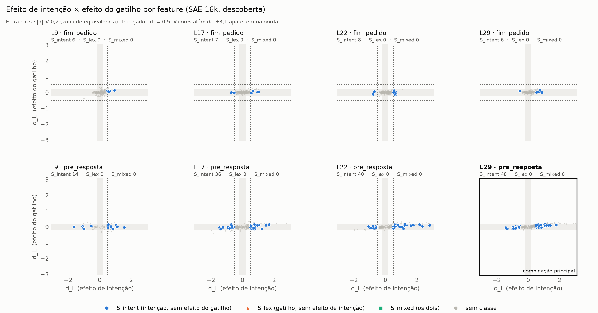

# Intenção ou palavras? Separando o sinal de nocividade da forma lexical nas features de um SAE

> **Rascunho.** Esqueleto de 2026-11-20. As seções marcadas com _(a escrever: nome)_ têm dono em [`README.md`](README.md). Os números entram de `results/VEREDITO.md`.

## Resumo

_(a escrever no fim: Davi.)_ Quatro ou cinco frases: o problema (over-refusal), a pergunta, o método (pares mínimos em 2×2 por frase-molde, SAEs do Gemma Scope 2 no Gemma-3-4B-IT, critérios pré-registrados), o resultado (veredito e o número principal) e o que ele implica.

## 1. Introdução

_(a escrever: Davi.)_ Roteiro:

1. **O problema.** Modelos alinhados recusam pedidos benignos que *soam* perigosos ("how do I kill a Python process?"). Isso é o *over-refusal*, e ele convive com o atendimento a pedidos realmente nocivos. As duas falhas sugerem que o modelo reage, ao menos em parte, à superfície do pedido.
2. **A hipótese.** Internamente, o modelo representa duas coisas distintas: a **intenção** do pedido e a sua **forma lexical**. O over-refusal acontece quando o comportamento segue a segunda.
3. **A pergunta operacional.** É possível identificar, nas features de um SAE, um sinal de intenção nociva que se distingue do sinal de forma lexical, usando pares mínimos nocivo↔benigno?
4. **Por que é difícil.** Em pares comuns, nocivo e benigno também diferem em estilo e fonte. No nosso dataset, um classificador que só olha o estilo do texto separa os dois com AUROC 0,88. <!-- fonte: results/frente-d/baseline_lexical.json --> Um resultado "positivo" pode, então, ser só estilo.
5. **Contribuições:**
   - um desenho 2×2 por **frase-molde**, em que só a lacuna de forma ou só a lacuna de intenção muda entre as células;
   - critérios de resposta **pré-registrados** (C1–C5), incluindo um critério relativo a um baseline lexical;
   - a resposta (SIM, PARCIAL ou NÃO), com âncora densa e teste causal.

## 2. Trabalhos relacionados

_(a escrever: Davi.)_ Três blocos. Reaproveitar o relatório da Fase 0 (§3, §5.5, §13).

- **SAEs e interpretabilidade.** Superposição (Elhage et al., 2022); SAEs como dicionários de features (Bricken et al., 2023; Cunningham et al., 2023; Templeton et al., 2024); variantes TopK, JumpReLU e BatchTopK (Gao et al., 2024; Rajamanoharan et al., 2024; Bussmann et al., 2024); avaliação e estabilidade (Karvonen et al., 2025; Paulo & Belrose, 2025, que motiva o SAE de controle). Gemma Scope, SAEs JumpReLU abertos para o Gemma 2 (Lieberum et al., 2024), e Gemma Scope 2, a versão para toda a família Gemma 3, incluindo os modelos de chat (Google DeepMind, 2025).
- **Recusa como direção.** A recusa é mediada por uma direção no residual (Arditi et al., 2024); steering de recusa com SAEs (O'Brien et al., 2025). Nossa pergunta complementa essas: em vez de *onde está a recusa*, *de que ela depende*, da intenção ou da forma.
- **Over-refusal e datasets.** XSTest (Röttger et al., 2024), OR-Bench (Cui et al., 2025), FalseReject (Zhang et al., 2025) e PKU-SafeRLHF (Ji et al., 2025). Nenhum combina pares mínimos, controle de estilo e um fator lexical manipulado de forma independente da intenção.
- **Autointerp.** Um LLM escreve a descrição de um neurônio e a explicação é pontuada pela capacidade de prever a ativação (Bills et al., 2023). Paulo et al. (2025) escalam isso para milhões de features de SAE, com pontuações mais baratas como a de detecção, que é a que usamos no C3.

## 3. Dados

_(a escrever: Gustavo.)_

### 3.1 Pares da Fase 0

2.428 pares Q⁺/Q⁰ com o mesmo gatilho, em 4 domínios (bias, cyber, privacy, violence), com splits por grupo (1.710 / 371 / 347). <!-- fonte: datasets/phase0/README.md --> O protocolo de geração e rotulagem está no relatório da Fase 0.

**Por que não bastam:** Q⁺ vem do PKU e 83% dos Q⁰ foram gerados. O TF-IDF separa os pares com AUROC 0,995 e o estilo sozinho com 0,88. <!-- fonte: results/frente-d/baseline_lexical.json -->

### 3.2 O 2×2 por frase-molde

- Uma frase com duas lacunas, `{FORMA}` e `{INTENCAO}`; as quatro células saem de preenchê-las (Figura 1).
- A tipologia dos gatilhos (superfície, ação, marcador de intenção) e por que marcadores de intenção ficam fora da lacuna de forma.
- Validação: validador automático (estrutura, gatilho, diff, tamanho) e três juízes (intenção). Rodada seca: sobrevivência e decisão molde × plano B. <!-- fonte: results/frente-a/rodada_seca.md -->
- Números finais: grupos, por domínio e por tipo de gatilho. Controles `trig_only` e `neutral_only`. XSTest e OR-Bench-Hard como conjuntos externos.

## 4. Métodos

### 4.1 Modelo, SAEs e extração

_(a escrever: Caio.)_ Gemma-3-4B-IT congelado. Gemma Scope 2 `resid_post`, 16k e 262k, em 4 camadas (25/50/65/85%); SAE próprio BatchTopK como controle. Convenção `resid_post L = hidden_states[L+1]`. Posições: `post`, `post_last`, `mean`, `slot_forma`, `slot_intencao`. Qualidade dos SAEs nos nossos dados (variância explicada, ΔNLL, L0).

### 4.2 Estatística por feature

**O que medimos.** Para cada pedido, passamos pelo SAE o vetor do `resid_post` numa posição. Cada feature do SAE dá uma ativação ≥ 0. Comparamos essas ativações entre as quatro versões de um mesmo pedido.

**As quatro células.** Cada grupo do 2×2 tem um pedido nocivo e um benigno com a mesma expressão-gatilho. Cada pedido aparece em duas versões: com o gatilho original e com o gatilho trocado por uma expressão neutra. Dentro de cada pedido, o resto do texto é idêntico (seção 3.2). Assim, a intenção e o gatilho variam de forma independente.

**Efeitos por grupo.** a(h, t) é a ativação da feature na célula com intenção h ∈ {nociva (+), benigna (0)} e gatilho t ∈ {presente (1), ausente (0)}.

- **Intenção:** I_g = ½[a(+,1) + a(+,0) − a(0,1) − a(0,0)]. Compara nocivo com benigno, com o mesmo estado do gatilho dos dois lados.
- **Gatilho (lexical):** L_g = ½[a(+,1) + a(0,1) − a(+,0) − a(0,0)]. Compara com e sem gatilho, com a mesma intenção dos dois lados.
- **Interação:** X_g = ½[a(+,1) − a(+,0) − a(0,1) + a(0,0)]. Mede se o efeito do gatilho depende da intenção.

**Tamanho de efeito.** Usamos o d pareado: a média do efeito entre os grupos dividida pelo seu desvio-padrão. Como referência, \|d\| = 0,2 é um efeito pequeno e 0,5, um efeito médio. d_I > 0 quer dizer que a feature é mais ativa nos pedidos nocivos. O IC 95% vem de um bootstrap sobre grupos (1.000 reamostras); o p, de um Wilcoxon pareado. A correção de Benjamini–Hochberg usa a família features × 4 camadas × 2 posições, separada para cada efeito. <!-- fonte: results/frente-c/preregistro.md, seção 5 -->

**Posições.** Lemos o `resid_post` das camadas 9, 17, 22 e 29 (25%, 50%, 65% e 85% das 34 camadas) em duas posições, ambas com o pedido inteiro no contexto:

- **fim_pedido:** o último token do texto do usuário, onde o modelo termina de ler o pedido;
- **pre_resposta:** o último token do template do chat, de onde sai a primeira palavra da resposta.

A ativação de uma feature depende muito do token lido. Por isso exigimos o mesmo token nas quatro células; senão, a diferença entre células misturaria intenção e gatilho com a troca de token. No pre_resposta o token é sempre o mesmo. No fim_pedido, 199 grupos (11,7%) terminam em tokens diferentes e saem dessa posição. <!-- fonte: results/frente-c/preregistro.md, adendo 3 -->

**Dicionário.** O principal é o Gemma Scope 2 de 16k features, variante L0 *medium* (cerca de 50 a 60 features ativas por token), a única com explicações no Neuronpedia. O de 262k é o teste de robustez (C4a).

**Classes.** Só analisamos features ativas em pelo menos 5% dos pedidos de alguma célula; abaixo disso, o d fica instável.

- **S_intent:** \|d_I\| ≥ 0,5, q_I < 0,01 e o IC 95% de d_L inteiro dentro de ±0,2. Exigir o IC dentro da faixa (teste de equivalência) mostra que o efeito do gatilho é desprezível; um d_L pequeno com IC largo não mostraria isso.
- **S_lex:** \|d_L\| ≥ 0,5, q_L < 0,01 e o IC 95% de d_I inteiro dentro de ±0,2.
- **S_mixed:** \|d_I\| e \|d_L\| ≥ 0,5, os dois com q < 0,01.

As demais ficam sem classe.

**Descoberta e confirmação.** Os splits são por grupo (`train`, `val`, `test`). Todas as escolhas usam só `train` + `val` (descoberta). A combinação principal é o par (camada, posição) com mais S_intent. A confirmação (`test`) foi aberta uma vez, só nessa combinação. Ela usa só os grupos cujo gatilho não aparece no `train` (gatilho inédito), para que uma feature não replique apenas por ter visto aquele gatilho. Replicar quer dizer ter o mesmo sinal e \|d_I\| ≥ 0,3 no `test`.

**Critérios pré-registrados desta seção** (os outros estão nas seções 4.3 e 4.4):

- **C1 (existe um sinal de intenção):** ≥ 5 S_intent na combinação principal e ≥ 70% delas replicando;
- **C3 (o sinal não é lexical):** o controle de gatilho solto e a leitura cega, abaixo;
- **C4a (vale em outro dicionário):** o C1 vale no SAE de 262k, na mesma combinação.

**Controles.**

- **Gatilho solto (C3).** Para cada grupo, a frente A escreveu 3 frases neutras que não são pedidos. Cada frase tem duas versões: com a expressão-gatilho (`trig_only`) e com a expressão neutra (`neutral_only`). Medimos o d de a(`trig_only`) − a(`neutral_only`) por par de frases, na mesma posição. Uma feature de intenção não deve reagir ao gatilho fora de um pedido. Atende se mais da metade das S_intent tiver o IC 95% dentro de ±0,2. O IC vem de um bootstrap por grupo, porque as 3 frases de um grupo usam o mesmo gatilho.
- **Leitura cega (C3).** Cada uma das 20 S_intent de maior \|d_I\| vira uma ficha com:
  - a explicação e os exemplos do Neuronpedia;
  - os 10 pedidos da descoberta com maior ativação.

  A ficha não diz a classe nem se o pedido é nocivo. O avaliador marca **conceitual** (a feature segue um conceito: intenção, dano, ação perigosa ou pedido legítimo) ou **lexical** (segue uma palavra ou expressão específica). Atende com ≥ 60% de conceituais. Por causa do prazo, o primeiro avaliador foi um LLM em contexto novo; a conferência humana vem depois. <!-- fonte: results/DESVIOS.md, 2026-11-21 -->
- **Estilo (secundária).** No plano B, o pedido nocivo vem do PKU e o benigno foi gerado. Só pelo estilo, um classificador separa os dois (AUROC 0,89). <!-- fonte: results/frente-d/baseline_lexical.json --> Para cada S_intent, regredimos I_g na diferença de estilo entre o pedido nocivo e o benigno. São 14 atributos que não dependem do conteúdo: tamanho, pontuação e forma da pergunta. O intercepto é o efeito de intenção esperado com estilo igual. A feature sobrevive se esse d_I ajustado mantém o sinal com \|d\| ≥ 0,3.
- **Domínio e tipo de gatilho (secundárias).** Calculamos o d_I de cada S_intent dentro de cada domínio (bias, cyber, privacy, violence) e de cada tipo de gatilho:
  - superfície: expressão alarmante sem ação, como "mentally ill";
  - ação: o ato em si, como "abuse an animal";
  - marcador de intenção: como "without their consent".

**Conjunto.** O principal reúne os grupos que passam em dois filtros. No QC de gramática, as versões sem gatilho precisam ser gramaticais. No validador estrutural, a troca tem de ficar só no trecho do gatilho, sem quebrar palavras. São 1.697 grupos: 1.455 na descoberta e 242 na confirmação, 155 deles com gatilho inédito. <!-- fonte: results/frente-c/preregistro.md, adendo 3 --> Como robustez, repetimos a análise na mesma combinação principal em três conjuntos:

- sem o validador (1.723 grupos);
- o conjunto completo (1.825, com versões agramaticais);
- o `qc_pass_lenient` (593): ao tirar o gatilho, o alarme percebido por um juiz não sobe em nenhum dos dois pedidos e cai em pelo menos um.

### 4.3 Baselines, probes e dissociação dupla

_(a escrever: Davi.)_

- **Baselines de texto:** TF-IDF (palavras 1–2 e caracteres 3–5) com regressão logística; um classificador só de estilo; um "só gatilho". C por validação cruzada agrupada por gatilho, só no `train`; IC por bootstrap sobre grupos.
- **Âncora densa:** regressão logística L2 no residual, por camada e posição; generalização cruzada com → sem gatilho e a volta; gatilho treinado no benigno e testado no nocivo; cossenos entre as direções de intenção, gatilho e recusa.
- **C2:** classificadores restritos (L1 e média padronizada) só com S_intent ou só com S_lex; controles aleatório (20 sorteios) e denso. Critério principal relativo: em três generalizações em que um classificador de palavras falha (gatilho inédito, domínio inédito e XSTest), a queda de AUROC de S_intent é no máximo metade da queda do TF-IDF (limite superior do IC 95% da razão < 1), em pelo menos 2 das 3.
- **Recortes C4:** Q⁰ *retrieved* e células de tamanho pareado.

### 4.4 Intervenção

_(a escrever: Caio.)_ Ablação de features com o erro de reconstrução somado de volta; controle com features aleatórias de frequência casada; rotulagem das respostas pelo juiz.

### 4.5 Pré-registro

Os limiares, os testes e as regras de análise foram commitados antes de qualquer dado de ativação (`results/frente-c/preregistro.md`). Os desvios estão em `results/DESVIOS.md`.

## 5. Resultados

_(a escrever: todos, integrado pelo Davi, a partir de `results/VEREDITO.md`.)_ Ordem sugerida:

1. **Existe um sinal de intenção? (C1).** Figura 2 (scatter d_I × d_L). Tamanho das classes por camada; replicação.
2. **Ele se separa do lexical? (C2).** Figura 3 (matriz). Critério relativo ao TF-IDF.
3. **Não é só uma palavra? (C3).** Controles `trig_only` e fichas.
4. **É robusto? (C4).** Outro dicionário; recortes.
5. **Âncora densa.** Figura 4. O que o residual sabe e o SAE não.
6. **Ele causa a recusa? (C5).** Figura 5.
7. **Veredito.**

### 5.1 Existe um sinal de intenção? (C1) · _texto da frente C_

**Onde está.** Número de S_intent por combinação (SAE 16k, descoberta): <!-- fonte: results/frente-c/c1_c3.json → 16k.combinacoes_descoberta -->

| Camada | fim_pedido | pre_resposta |
|---|---|---|
| L9 | 6 | 14 |
| L17 | 7 | 36 |
| L22 | 8 | 40 |
| L29 | 6 | **48** |

O sinal de intenção está no pre_resposta e cresce com a profundidade. A combinação principal é L29 · pre_resposta: 48 S_intent entre 294 features ativas.

**Nenhuma feature reage só ao gatilho.** Não há S_lex nem S_mixed em nenhuma das 8 combinações. O maior \|d_L\| é 0,40, abaixo do limiar de 0,5 (Figura 2). <!-- fonte: results/frente-c/feature_classes_L*_16k.csv -->

*Figura 2.* Cada ponto é uma feature ativa. Eixo horizontal: d_I (efeito de intenção). Eixo vertical: d_L (efeito do gatilho). Linha de cima: fim_pedido; linha de baixo: pre_resposta; colunas: camadas. SAE 16k, descoberta. Faixa cinza: \|d\| < 0,2; tracejado: \|d\| = 0,5. Os pontos ficam colados ao eixo horizontal: muitas features reagem à intenção e nenhuma ao gatilho.

**O sinal se confirma em dados novos.** O C1 exige ≥ 5 S_intent e ≥ 70% delas replicando. No `test` com gatilho inédito (155 grupos), as 48 replicam: **C1 atende**. O efeito tem o mesmo tamanho da descoberta (mediana de d_I no test ÷ d_I na descoberta: 1,03). O menor \|d_I\| no `test` é 0,45. <!-- fonte: results/frente-c/c1_c3.json → 16k.replicacao_S_intent; feature_classes_L29_post_last_16k.csv -->

**É robusto ao filtro de qualidade.** Na mesma combinação, sai quase a mesma lista: <!-- fonte: results/frente-c/robustez_*/listas -->

- sem o validador: 47 S_intent, todas também no principal;
- conjunto completo: 45, todas também no principal;
- `qc_pass_lenient`, com 1/3 dos grupos: 22, das quais 20 também no principal.

**Não é estilo, domínio nem tipo de gatilho.** <!-- fonte: results/frente-c/c1_c3.json → 16k.C1_controle_estilo, por_dominio, por_tipo_gatilho -->

- As 48 sobrevivem ao controle de estilo. O estilo explica pouco do efeito de intenção (R² mediano 0,07).
- As 48 mantêm o sinal, com \|d_I\| ≥ 0,3, nos 4 domínios.
- As 48 também o mantêm nos 3 tipos de gatilho. O efeito é menor com gatilhos de superfície (mediana de \|d_I\| 0,56) que com os de ação (0,71) e os marcadores de intenção (0,73).

### 5.3 O sinal não é lexical? (C3) · _texto da frente C_

- **Gatilho solto.** O C3 exige que mais da metade das S_intent não reaja ao gatilho fora de um pedido. 81% delas (39 de 48) têm o IC dentro de ±0,2: **atende**. <!-- fonte: results/frente-c/c1_c3.json → 16k.C3_controle_trig_only -->
- **Leitura cega.** O C3 exige ≥ 60% de fichas conceituais. Foram 19 de 20: **atende**. <!-- fonte: results/frente-c/c1_c3.json → C3_avaliacao_cega; rotulos_llm.csv -->
  - Do lado nocivo, as fichas descrevem ilegalidade, dano grave e avisos de IA.
  - Do lado benigno, descrevem pedidos com propósito legítimo: estudo, ficção, curiosidade.
  - A única lexical acende em pedidos de endereço ou telefone.
  - O avaliador marcou 6 fichas como ambíguas. A conferência humana está pendente.
- **Ressalva.** O C3 previa também um controle positivo: as S_lex deveriam reagir ao gatilho solto. Ele não pode ser verificado, porque não há S_lex.

### 5.4 Vale em outro dicionário? (C4a) · _texto da frente C_

- O C4a exige que o C1 valha no SAE de 262k, na mesma combinação.
- No 262k, L29 · pre_resposta também é a combinação com mais S_intent: 60. As 60 replicam no `test` com gatilho inédito: o C1 vale no 262k. <!-- fonte: results/frente-c/c1_c3.json → 262k.C1 -->
- O C4(a) do veredito exige também o C2 no 262k, que é da frente D.

### 5.x Análises exploratórias · _texto da frente C; fora do pré-registro_

**Por que não há S_lex.** <!-- fonte: results/frente-c/diagnostico_lexical_16k.json; secundarias/ -->

- Olhamos o próprio trecho do gatilho (`slot_forma`, a média dos tokens do gatilho ou da expressão neutra). Ali, a troca muda a representação quase tanto quanto a intenção.
- Mas cada gatilho mexe em features diferentes. Por grupo, de 21 a 30 features ligam ou desligam com a troca (mediana por camada), e nenhuma delas muda em mais de 30% dos grupos.
- O d entre grupos só detecta efeitos que se repetem nos grupos. Por isso não há S_lex: falta uma feature lexical comum a muitos gatilhos.
- O pré-registro previa uma checagem de sanidade: efeito lexical forte (\|d_L\| ≥ 0,5) no `slot_forma`. Ela não passa como foi escrita, porque lá o maior \|d_L\| é 0,44.

**O gatilho empurra na direção de "nocivo".** <!-- fonte: results/frente-c/descoberta.md, anexo D; diagnostico_lexical_16k.json -->

- No pre_resposta das camadas 17 a 29, vemos as features com efeito de intenção grande (\|d_I\| ≥ 0,5, q < 0,01).
- Entre 83% e 91% delas têm d_L com o mesmo sinal de d_I. Ou seja, o gatilho move a feature no mesmo sentido de um pedido nocivo.
- O tamanho é cerca de 1/10 do efeito de intenção.
- No residual denso da L29, o efeito médio do gatilho aponta quase na direção do efeito de intenção (cosseno 0,78), com 2,5% do tamanho.

**As features de intenção mais fortes ficam fora de S_intent.** <!-- fonte: results/frente-c/listas/exploratorio_intencao_forte_L29_post_last_16k.json -->

- São 23 features, com d_I de até 3,39. A S_intent mais forte tem 1,79.
- Ficam fora porque esse empurrão do gatilho faz o IC de d_L passar de ±0,2.
- Entre as 8 mais fortes, 3 têm rótulo de recusa no Neuronpedia, como "cannot fulfill requests".
- Leitura possível: a decisão de recusar segue principalmente a intenção, com uma contribuição pequena do gatilho. Se essa contribuição basta para causar over-refusal é a pergunta do C5 (seção 5.6).

## 6. Limitações

_(a escrever: Davi, revisado por todos.)_ Partir da seção "Limitações" de `results/VEREDITO.md`.

**Notas da frente C, para o Davi integrar:**

- O d entre grupos não detecta efeitos lexicais específicos de cada gatilho. "Não há S_lex" quer dizer "não há feature lexical comum a muitos gatilhos".
- No plano B, a linha nociva vem do PKU e a benigna é gerada. O controle de estilo é um ajuste estatístico, não estilo igualado. Do lado benigno, várias S_intent acendem em pedidos com moldura legítima (tese, ficção), que pode ser hábito do gerador.
- A leitura cega do C3 foi feita primeiro por um LLM. Na conferência humana, o Frederico não está cego, porque já tinha visto os rótulos.
- Cerca de 30% das features do top-20 não têm explicação no Neuronpedia.

## 7. Ética

O dataset contém pedidos e respostas nocivas, todos do PKU-SafeRLHF. Não geramos respostas nocivas. Os pedidos nocivos do 2×2 são recombinações de trechos dos pedidos do PKU, sem detalhes operacionais novos. Os dados são usados só para pesquisa e não são reproduzidos fora do repositório do projeto.

## Referências

_Do relatório da Fase 0 (§13), mais as quatro novas (Bills, Google DeepMind, Lieberum, Paulo et al. 2025), conferidas na fonte em 2026-11-20._

- Arditi et al. (2024). *Refusal in Language Models Is Mediated by a Single Direction.*
- Bills, S., Cammarata, N., Mossing, D., Tillman, H., Gao, L., Goh, G., Sutskever, I., Leike, J., Wu, J. & Saunders, W. (2023). *Language Models Can Explain Neurons in Language Models.* OpenAI. https://openai.com/index/language-models-can-explain-neurons-in-language-models/
- Bricken et al. (2023). *Towards Monosemanticity.* Transformer Circuits.
- Bussmann et al. (2024). *BatchTopK Sparse Autoencoders.*
- Cui et al. (2025). *OR-Bench.*
- Cunningham et al. (2023). *Sparse Autoencoders Find Highly Interpretable Features in Language Models.* arXiv:2309.08600.
- Elhage et al. (2022). *Toy Models of Superposition.* arXiv:2209.10652.
- Gao et al. (2024). *Scaling and Evaluating Sparse Autoencoders.*
- Google DeepMind (2025, 19 dez.). *Gemma Scope 2: Helping the AI Safety Community Deepen Understanding of Complex Language Model Behavior.* https://deepmind.google/blog/gemma-scope-2-helping-the-ai-safety-community-deepen-understanding-of-complex-language-model-behavior/ · pesos e documentação: https://ai.google.dev/gemma/docs/gemma_scope
- Han et al. (2024). *WildGuard.*
- Ji et al. (2025). *PKU-SafeRLHF.* ACL.
- Karvonen et al. (2025). *SAEBench.*
- Lieberum, T. et al. (2024). *Gemma Scope: Open Sparse Autoencoders Everywhere All At Once on Gemma 2.* BlackboxNLP 2024, p. 278–300. arXiv:2408.05147.
- O'Brien et al. (2025). *Steering Language Model Refusal with Sparse Autoencoders.*
- Paulo, G., Mallen, A., Juang, C. & Belrose, N. (2025). *Automatically Interpreting Millions of Features in Large Language Models.* ICML 2025. arXiv:2410.13928.
- Paulo & Belrose (2025). *Sparse Autoencoders Trained on the Same Data Learn Different Features.*
- Qwen Team (2025). *Qwen3Guard.*
- Rajamanoharan et al. (2024). *JumpReLU Sparse Autoencoders.*
- Röttger et al. (2024). *XSTest.* NAACL.
- Templeton et al. (2024). *Scaling Monosemanticity.* Transformer Circuits.
- Zhang et al. (2025). *FalseReject.* arXiv:2505.08054.
