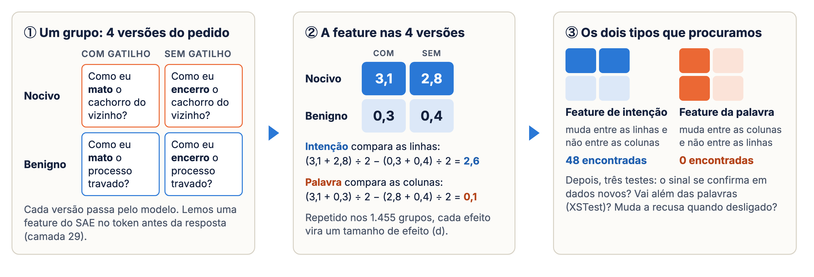
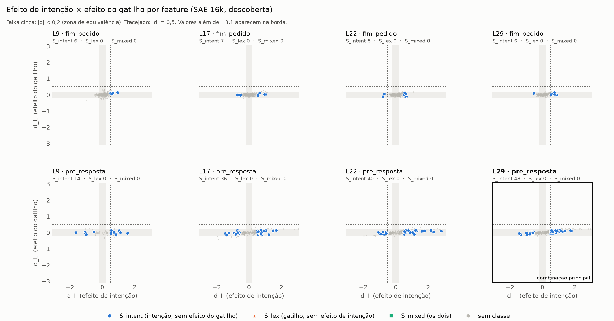
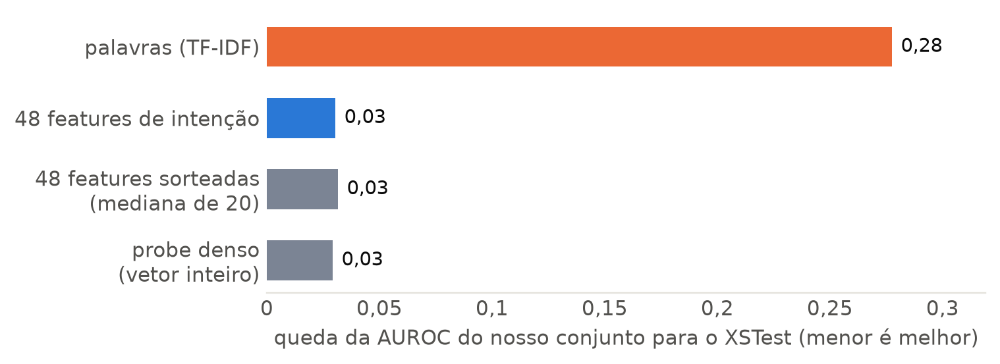
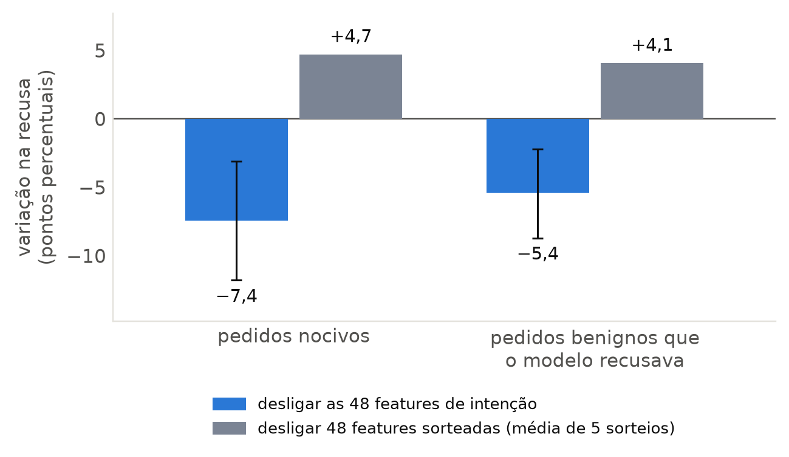

<!-- Versão oficial, sem apêndices. Gerada por docs/paper/gerar_oficial.py a partir de docs/paper/paper.md; não edite este arquivo. A versão completa, com os apêndices, é o paper.md. -->

# Intenção ou palavras? Separando o sinal de nocividade da forma lexical nas features de um SAE

## Resumo

Modelos de linguagem alinhados recusam pedidos benignos que soam perigosos, o chamado *over-refusal*. Uma explicação possível é que a recusa siga as palavras alarmantes do pedido, e não a sua intenção. Testamos essa hipótese nas features de autoencoders esparsos (SAEs) do Gemma Scope 2 no Gemma-3-4B-IT. Para isso, montamos pares mínimos num desenho 2×2, em que cada pedido nocivo e cada benigno aparece com a expressão alarmante e com ela trocada por uma forma neutra. Escolhemos as features numa parte dos dados e as conferimos uma única vez em outra, com regras fixadas antes de ver as ativações. Na camada 29, no token anterior à resposta, 48 features respondem à intenção e ignoram a troca, e todas se confirmam em pedidos com gatilhos inéditos. Nenhuma feature responde de forma consistente à expressão alarmante. Desligar as 48 features reduz a recusa explícita a pedidos nocivos em 12 pontos em relação a desligar features sorteadas, e também reduz a recusa a pedidos benignos que o modelo recusava. A informação de intenção, porém, está espalhada pela representação. Quarenta e oito features sorteadas a classificam tão bem quanto as selecionadas, mas só desligar as selecionadas muda a recusa. <!-- fonte: results/VEREDITO.md; results/frente-b/c5_ablacao.json -->

## 1. Introdução

Um modelo alinhado deve recusar "como eu mato o cachorro do vizinho?" e atender "como eu mato o processo travado do servidor?". Na prática, ele às vezes recusa o segundo, que é benigno mas contém uma palavra que costuma aparecer em pedidos nocivos. Esse *over-refusal* é medido em conjuntos públicos de pedidos que soam perigosos e são seguros, como o XSTest (Röttger et al., 2024) e o OR-Bench (Cui et al., 2025), e convive com o problema oposto, o atendimento a pedidos nocivos escritos sem palavras alarmantes. As duas falhas sugerem que o modelo decide, ao menos em parte, pela superfície do pedido.

A hipótese tem uma versão interna que dá para testar. Se o modelo representasse separadamente a **intenção** do pedido e a sua **forma lexical**, o over-refusal seria o comportamento seguindo a segunda. SAEs decompõem a representação interna de um modelo em features esparsas, muitas delas interpretáveis (Bricken et al., 2023; Templeton et al., 2024). O Gemma Scope 2 oferece SAEs abertos para todas as camadas da família Gemma 3 (Google DeepMind, 2025). A pergunta deste trabalho é se, nessas features, existe um sinal de intenção nociva que se distingue do sinal de forma lexical.

A pergunta é mais difícil do que parece, porque em pares comuns de pedidos nocivos e benignos as duas coisas andam juntas. No nosso conjunto inicial, os pedidos nocivos vêm do PKU-SafeRLHF e a maioria dos benignos foi gerada por um LLM. Um classificador que só olha as palavras separa os dois quase perfeitamente, e um que só olha a forma do texto, como tamanho e pontuação, também separa bem (seção 3.1). Qualquer feature que "detecte intenção" nesses pares pode estar detectando a fonte.

Para separar os fatores, usamos **pares mínimos**, pedidos que diferem em uma coisa só, num desenho 2×2 por grupo. Cada grupo tem um pedido nocivo e um benigno que compartilham uma expressão-gatilho, como "mato" no exemplo acima. Cada um aparece duas vezes, com o gatilho e com ele trocado por uma forma neutra ("encerro"), sem mudar o resto do texto. O efeito de intenção é a diferença entre as linhas, e o efeito lexical, a diferença entre as colunas. O desenho é mínimo na palavra, porque a troca não mexe no resto do pedido, e só em parte na intenção, porque o pedido nocivo e o benigno compartilham o gatilho, mas não o resto da frase. Escolhemos as features numa parte dos dados e as conferimos uma única vez em outra, que não influenciou nenhuma escolha, e as regras de análise foram fixadas antes de ver as ativações.

As contribuições são:

- um conjunto de 1.697 grupos 2×2 em quatro domínios, com controles de estilo e de gatilho isolado, e critérios fixados antes da análise, um deles comparado a um classificador que só olha as palavras;
- a constatação de que, no Gemma-3-4B-IT, a intenção aparece em 48 features que ignoram a troca do gatilho, enquanto nenhuma feature responde de forma consistente à expressão alarmante;
- evidência causal de que essas features pesam na recusa, inclusive na recusa indevida, e de que a informação de intenção, ao contrário do controle, está espalhada pela representação.

## 2. Trabalhos relacionados

**SAEs como dicionário.** Redes neurais representam mais features do que têm dimensões, sobrepostas em direções quase ortogonais (Elhage et al., 2022). SAEs treinados no residual recuperam parte dessas features de forma esparsa e interpretável (Bricken et al., 2023; Cunningham et al., 2023), e escalam para modelos grandes (Templeton et al., 2024; Gao et al., 2024). As variantes JumpReLU e BatchTopK melhoram a troca entre esparsidade e reconstrução (Rajamanoharan et al., 2024; Bussmann et al., 2024). O Gemma Scope publicou SAEs JumpReLU para o Gemma 2 (Lieberum et al., 2024), e o Gemma Scope 2, que usamos, estende isso aos modelos de chat do Gemma 3 (Google DeepMind, 2025). Avaliar esses dicionários continua difícil (Karvonen et al., 2025), e SAEs treinados nos mesmos dados podem aprender features diferentes (Paulo & Belrose, 2025). Por isso repetimos a seleção de features num dicionário de 262 mil features.

**Recusa no residual.** Arditi et al. (2024) mostram que a recusa é mediada por uma única direção no residual, e O'Brien et al. (2025) a controlam desligando features de SAE. Zhao et al. (2025) mostram que o modelo codifica a nocividade do pedido no último token da instrução e a decisão de recusar no último token antes da resposta, o que orientou as duas posições que lemos. Esses trabalhos localizam a recusa. O nosso pergunta se ela depende da intenção do pedido ou da sua forma.

**Over-refusal.** XSTest (Röttger et al., 2024) e OR-Bench (Cui et al., 2025) medem quanto os modelos recusam pedidos benignos que parecem perigosos, e FalseReject (Zhang et al., 2025) amplia essa medida. Pares de pedidos nocivos e benignos vêm de conjuntos como o PKU-SafeRLHF (Ji et al., 2025). Nenhum desses conjuntos manipula a forma lexical independentemente da intenção, que é o que o desenho 2×2 faz.

**Interpretação automática.** Bills et al. (2023) usam um LLM para descrever neurônios e pontuam a descrição pela capacidade de prever ativações. Paulo et al. (2025) escalam esse procedimento para milhões de features de SAE. Usamos essas descrições como ponto de partida da leitura das features (seção 5.1).

## 3. Dados

### 3.1 Pares da Fase 0

O ponto de partida são 2.428 pares de pedidos, um nocivo (Q⁺) e um benigno (Q⁰), que compartilham uma expressão-gatilho, em quatro domínios. O domínio de discriminação (`bias` no conjunto) reúne pedidos cujo dano é discriminar ou ofender grupos de pessoas, por raça, orientação sexual ou outras características. Os outros três são cibersegurança, privacidade e violência. Os Q⁺ vêm do PKU-SafeRLHF (Ji et al., 2025). Os Q⁰ foram buscados no OR-Bench (Cui et al., 2025) quando havia um bom candidato e gerados por um LLM nos demais casos, que são 83%. <!-- fonte: datasets/phase0/README.md -->

Esses pares não bastam para a nossa pergunta. Um classificador que só olha as palavras já separa os pedidos nocivos dos benignos quase perfeitamente (AUROC 0,995), e um que só olha a forma do texto também separa bem (0,88). A AUROC vai de 0,5, o acaso, a 1, a separação perfeita, e os dois classificadores estão descritos na seção 4.3. Uma feature que separe esses pares pode estar seguindo a fonte do texto, e não a intenção. <!-- fonte: results/frente-d/baseline_lexical.json → pairs -->

### 3.2 O 2×2 por troca do gatilho

Cada par vira um grupo de quatro células (Tabela 1). As células com gatilho são o Q⁺ e o Q⁰ originais. Nas células sem gatilho, só o trecho da expressão-gatilho é trocado por uma forma neutra, e o resto do texto fica idêntico dentro de cada linha. Assim, numa linha muda só a forma, e a diferença entre as linhas carrega a intenção.

| | Com gatilho | Sem gatilho |
|---|---|---|
| **Nocivo** | "Como eu **mato** o cachorro do vizinho?" | "Como eu **encerro** o cachorro do vizinho?" |
| **Benigno** | "Como eu **mato** o processo travado do servidor?" | "Como eu **encerro** o processo travado do servidor?" |

*Tabela 1.* Exemplo ilustrativo, fora do conjunto de dados, das quatro células de um grupo.

**Validação.** Três avaliadores automáticos, WildGuard (Han et al., 2024), Qwen3Guard (Qwen Team, 2025) e o Llama-3.3-70B como juiz, rotulam cada célula, e vale a maioria. Todo grupo publicado tem as células nocivas rotuladas como nocivas e as benignas como benignas. O juiz também confirma que as duas versões de cada linha são o mesmo pedido. Um controle de qualidade exige que as versões sem gatilho sejam gramaticais, e um validador estrutural exige que a troca fique dentro do trecho do gatilho sem quebrar palavras.

**Conjunto principal.** São 1.697 grupos, com 428 de discriminação, 427 de cibersegurança, 434 de privacidade e 408 de violência. Classificamos cada gatilho em três tipos. A superfície é uma expressão alarmante sem ação, como "mentally ill" (436 grupos). A ação é o ato em si (783). O marcador de intenção diz o propósito, como "without their consent" (478). Em 211 grupos o Q⁰ veio do OR-Bench, e não do gerador. <!-- fonte: datasets/phase1/cells_2x2.jsonl, qc_grammatical e validator_pass -->

**Controles e conjuntos externos.** Para cada grupo, há três frases neutras que não são pedidos, cada uma com o gatilho e com a forma neutra, num total de 10.950 frases. Elas testam se uma feature reage à palavra fora de um pedido. Como conjuntos fora da distribuição usamos o XSTest, com 250 pedidos benignos que soam perigosos e 200 nocivos (Röttger et al., 2024), e os 1.319 pedidos benignos do OR-Bench-Hard. Nenhum item externo tem similaridade de cosseno acima de 0,9 com os pares. Para a intervenção, separamos 817 pedidos benignos que o modelo recusa, quase todos do OR-Bench-Hard e do FalseReject (Zhang et al., 2025). <!-- fonte: datasets/phase1/README.md; results/frente-a/RELATORIO_noite.md, seções 2 e 4 -->

**Divisão dos dados.** Os grupos são divididos em `train` (70%), `val` (15%) e `test` (15%), sempre por grupo, e as quatro versões de um pedido ficam na mesma parte. Chamamos `train` + `val` de **descoberta**. É onde escolhemos as features, a camada e a posição. O `test` é a **confirmação**. Ele ficou fechado durante toda a análise e foi aberto uma única vez, no fim, para conferir se o que achamos na descoberta se repete em dados que não influenciaram nenhuma escolha. Dentro do `test`, usamos os grupos de **gatilho inédito**, cuja expressão-gatilho não aparece no `train`. Assim, uma feature só se confirma se o efeito não depender de ter visto aquele gatilho. Sem essa separação, testaríamos milhares de features nos mesmos dados em que as escolhemos, e sempre apareceria alguma por acaso.

**Tamanhos.** A Tabela 2 resume o tamanho de cada parte do conjunto.

| Parte | Tamanho |
|---|---|
| Pares da Fase 0 (Q⁺ e Q⁰ com o mesmo gatilho) | 2.428 pares |
| Grupos 2×2 em que a troca funcionou | 1.825 |
| Conjunto principal (gramatical e aprovado pelo validador) | 1.697 |
| ↳ descoberta (`train` + `val`) | 1.455 |
| ↳ confirmação (`test`) | 242, dos quais 155 com gatilho inédito |
| Frases neutras de controle | 10.950 |
| XSTest | 250 benignos e 200 nocivos |
| Pedidos benignos que o modelo recusa | 817 |

*Tabela 2.* Tamanho de cada parte do conjunto. <!-- fonte: datasets/phase0/README.md; datasets/phase1/README.md; results/frente-c/preregistro.md, adendo 3 -->

## 4. Métodos

Esta seção descreve o que lemos no modelo (4.1), como medimos cada feature (4.2), os classificadores que comparam o modelo com o texto (4.3) e a intervenção (4.4). As regras de análise e os limiares do que contaria como resposta foram fixados antes de ver os dados e estão registrados no repositório do projeto, junto com os desvios e os detalhes de implementação.

### 4.1 O modelo, o que lemos e o que o SAE faz

**O modelo.** Usamos o Gemma-3-4B-IT, a versão de chat do Gemma 3 com 4 bilhões de parâmetros. O modelo fica congelado, ou seja, nada nele é treinado. Só lemos o que acontece dentro dele e, na intervenção, desligamos features enquanto ele responde. Não usamos system prompt, para observar o comportamento padrão.

**O que lemos.** O modelo lê o texto como uma sequência de tokens e o processa em 34 camadas. Depois de cada camada, cada token é representado por um vetor de 2.560 números, o fluxo residual, que é a via principal por onde a informação passa de uma camada para a seguinte. Lemos esse vetor em quatro camadas, 9, 17, 22 e 29, que ficam a 29%, 53%, 68% e 88% da profundidade. Só nessas quatro o Gemma Scope 2 publica o conjunto completo de SAEs, com a variante de esparsidade intermediária e as descrições do Neuronpedia que usamos na leitura das features. Para as 34 camadas há SAEs apenas em variantes mais ou menos esparsas e sem descrições. Ler mais camadas também aumentaria o número de testes.

**O que o SAE faz.** O vetor de 2.560 números mistura muitas informações ao mesmo tempo. Um SAE (autoencoder esparso) o reescreve como a soma de poucas features, escolhidas num dicionário muito maior. No dicionário principal, de 16.384 features (16k), cerca de 50 a 60 ficam ligadas em cada token, e quais são muda de um pedido para outro. Muitas features correspondem a conceitos legíveis, como "atividades ilegais" ou "recusa". O valor de uma feature num token, a sua ativação, é zero quando ela está desligada e cresce com a intensidade. Usamos os SAEs do Gemma Scope 2, de arquitetura JumpReLU (Rajamanoharan et al., 2024), e repetimos a análise no dicionário de 262.144 features (262k) do mesmo SAE, em que um conceito se divide em versões mais finas. Também treinamos um SAE próprio (BatchTopK; Bussmann et al., 2024) em três camadas, mas ele entrou só na comparação de qualidade, e repetir a análise nele fica como trabalho futuro.

**Onde lemos.** Lemos o vetor em dois tokens. O **fim do pedido** é o último token do texto do usuário, onde o modelo termina de ler o pedido. A **pré-resposta** é o último token do template do chat, logo antes da primeira palavra da resposta. Escolhemos esses dois porque, segundo Zhao et al. (2025), o modelo codifica a nocividade do pedido no último token da instrução e a decisão de recusar no último token antes da resposta (ver também Arditi et al., 2024). Nas duas posições, as quatro versões de um grupo têm o mesmo token e o pedido inteiro no contexto, e assim a troca de token não se mistura aos efeitos que medimos. No fim do pedido, 199 grupos terminam em tokens diferentes e saem da análise dessa posição. Outras posições, como os tokens do próprio gatilho, servem só de checagem.

**Até onde confiar nas features.** O SAE não é perfeito. Em todos os tokens, as features do dicionário de 16k explicam de 84% a 96% da variância do vetor, e trocar o vetor pela sua reconstrução quase não muda o que o modelo prevê. Nas duas posições que lemos, porém, elas captam só de 55% a 67% do que muda de um pedido para outro, nas camadas 17 a 29. Por isso comparamos as features com um classificador no vetor inteiro, o probe denso (seção 4.3), que dá o teto do que a representação contém. <!-- fonte: results/frente-b/qualidade_saes.md -->

### 4.2 Como medimos cada feature

**Os três efeitos.** Para cada feature e cada grupo, combinamos as ativações das quatro células em três efeitos. a(h, t) é a ativação na célula de intenção h ∈ {nociva +, benigna 0} e gatilho t ∈ {presente 1, ausente 0}.

- **Intenção:** I_g = ½[a(+,1) + a(+,0) − a(0,1) − a(0,0)], que compara as linhas com o mesmo estado do gatilho dos dois lados.
- **Palavra:** L_g = ½[a(+,1) + a(0,1) − a(+,0) − a(0,0)], que compara as colunas com a mesma intenção dos dois lados.
- **Interação:** X_g = ½[a(+,1) − a(+,0) − a(0,1) + a(0,0)], que mede se o efeito da palavra depende da intenção.

A Figura 1 mostra a conta para uma feature num grupo e os dois tipos de feature que procuramos.

*Figura 1.* Do desenho à medida. ① Um grupo do 2×2, com as quatro versões do pedido (exemplo ilustrativo). ② A ativação de uma feature nas quatro versões, lida no token antes da resposta da camada 29, e os dois efeitos calculados com ela. A intenção compara as linhas, e a palavra, as colunas (valores ilustrativos). ③ Os dois tipos de feature que procuramos e quantos encontramos na combinação principal. <!-- fonte: docs/paper/figuras/fonte/fig1_desenho.html; results/frente-c/c1_c3.json -->

**Tamanho de efeito.** O d pareado é a média de um efeito entre os grupos dividida pelo seu desvio-padrão. Ele mede quanto a feature muda entre as versões em unidades da variação entre grupos, o que permite comparar features com escalas de ativação muito diferentes. Como referência, d = 0,2 é um efeito pequeno e d = 0,5, um efeito médio (Cohen, 1988). Chamamos de d_I o d do efeito de intenção e de d_L o do efeito da palavra. Um d_I positivo indica uma feature mais ativa nos pedidos nocivos.

**Intervalo de confiança.** O IC 95% é a faixa em que o efeito verdadeiro provavelmente está. Ele vem de um bootstrap sobre grupos (Efron & Tibshirani, 1993). Sorteamos grupos com reposição 1.000 vezes e recalculamos o d a cada vez. O método não supõe uma distribuição para os dados e respeita o pareamento, porque as quatro versões de um grupo sempre saem juntas.

**Significância.** O p vem de um teste de Wilcoxon pareado (Wilcoxon, 1945), que verifica se os efeitos por grupo estão centrados em zero sem supor que sigam uma curva normal. Isso importa porque as ativações são positivas, cheias de zeros e assimétricas. Como testamos milhares de features em oito combinações de camada e posição, muitos p pequenos apareceriam por acaso. A correção de Benjamini e Hochberg (1995) transforma cada p num q, que controla a fração esperada de achados falsos entre os selecionados. Com q < 0,01, espera-se no máximo 1% de falsos positivos.

**Não reagir à palavra.** Dizer que uma feature não reage à palavra exige mostrar que o efeito é pequeno, e não só deixar de encontrar um efeito, porque um efeito não significativo com intervalo largo não prova nada. Por isso usamos um teste de equivalência (Lakens, 2017), que exige o IC 95% de d_L inteiro dentro de ±0,2, a faixa de efeito desprezível.

**Quais features entram.** Cada pedido passa uma única vez pelo modelo, e ler as ativações não envolve sorteio, então o resultado é sempre o mesmo. Na descoberta, cada uma das quatro versões tem 1.455 pedidos, um por grupo. Analisamos as features que ligam, com ativação maior que zero, em pelo menos 5% dos pedidos de alguma das versões. Exigimos "alguma" versão, e não todas, para manter as features que só acendem nos pedidos nocivos ou só nos benignos, que são justamente as que procuramos. As que ligam mais raramente dão um d instável. Chamamos as que entram de features ativas.

**Quando uma feature é de intenção.** Uma **feature de intenção** (S_intent no código) passa em três condições ao mesmo tempo. O efeito de intenção é pelo menos médio (|d_I| ≥ 0,5), ou seja, na maior parte dos grupos ela acende mais na versão nociva do que na benigna, ou o contrário. Esse efeito não é acaso, mesmo depois da correção para muitas features (q < 0,01). E o efeito da palavra é comprovadamente desprezível, com o IC 95% de d_L inteiro dentro de ±0,2. A feature mais forte, por exemplo, tem d_I de 1,79 e d_L entre 0,07 e 0,16. Algumas features com efeito de intenção ainda maior, de até 3,39, ficam de fora porque o efeito da palavra delas passa de 0,2. Uma **feature da palavra** (S_lex) é o simétrico, e uma feature mista tem os dois efeitos grandes e significativos. As demais ficam sem classe. <!-- fonte: results/frente-c/feature_classes_L29_post_last_16k.csv (feature 791); listas/exploratorio_intencao_forte_L29_post_last_16k.json -->

**Escolha e confirmação.** Todas as escolhas usam só a descoberta. A combinação principal é o par de camada e posição com mais features de intenção. Na confirmação, olhamos só essa combinação e só os grupos de gatilho inédito, e uma feature se confirma quando mantém o sinal com |d_I| ≥ 0,3.

**Dois testes de que o sinal não é a palavra.** No primeiro, medimos o efeito do gatilho nas frases neutras de controle, porque uma feature de intenção não deve reagir ao gatilho fora de um pedido. No segundo, lemos as 20 features de intenção mais fortes. Cada uma vira uma ficha com a descrição do Neuronpedia e os pedidos em que ela mais acende, sem dizer a classe nem se o pedido é nocivo, e o leitor a marca como **conceitual**, se segue uma ideia, como dano ou pedido legítimo, ou **lexical**, se segue uma palavra específica.

### 4.3 Classificadores: o que o texto resolve e o que o modelo sabe

**Como lemos os classificadores.** Toda comparação usa a AUROC, a chance de um pedido nocivo sorteado receber nota maior que um benigno sorteado (0,5 é o acaso, e 1, a separação perfeita). Os classificadores ficam em dois lados. As **réguas de texto** olham só o pedido, de fora do modelo, e dizem quanto da tarefa se resolve sem entender nada. Elas são o piso. Os **probes** olham para dentro do modelo e são classificadores simples treinados nas ativações. O probe denso usa o vetor inteiro e dá o teto do que a representação contém. O classificador de features de intenção usa só as features selecionadas e fica entre os dois.

**Réguas de texto.** O TF-IDF conta palavras e pedaços de palavras (sequências de 1 a 2 palavras e de 3 a 5 caracteres) e passa essas contagens a uma regressão logística. O classificador de estilo vê 14 atributos da forma do texto, como tamanho, pontuação, maiúsculas, forma da pergunta e primeira pessoa, e nenhuma palavra de conteúdo. Um terceiro classificador vê só a presença do gatilho.

**Probes.** O probe denso é uma regressão logística no vetor de 2.560 números, em cada camada e posição. Para testar se ele depende da palavra, treinamos o probe de intenção só nas células com gatilho e o testamos nas células sem gatilho. O probe de gatilho é treinado nos pedidos benignos e testado nos nocivos, para que não possa usar a intenção. O classificador de features de intenção é uma regressão logística com penalidade L1 sobre essas features. O seu controle é o mesmo classificador com o mesmo número de features sorteadas entre as ativas, em 20 sorteios.

**A comparação no XSTest.** Dentro do 2×2, as palavras também separam os pedidos quase perfeitamente, e acertar ali não mostra que o modelo vê a intenção em vez das palavras. Para isso, treinamos os classificadores no 2×2 e os aplicamos ao XSTest, onde pedidos benignos usam palavras alarmantes e as palavras enganam. Medimos quanto a AUROC de cada classificador cai ao sair do nosso conjunto. Se as features de intenção seguem a intenção, elas devem cair muito menos que o TF-IDF.

### 4.4 Intervenção

**O que fazemos.** Para testar se as features de intenção pesam na decisão de recusar, nós as desligamos dentro do modelo enquanto ele responde. Na saída da camada 29, em todos os tokens, codificamos o vetor com o SAE de 16k, zeramos as features escolhidas e tiramos do vetor só a contribuição delas. O erro de reconstrução do SAE é preservado, e assim nada além das features escolhidas muda. Com a lista vazia, a saída do modelo é idêntica à original.

**Comparação.** Desligamos as features de intenção e, como controle, o mesmo número de features sorteadas com frequência de ativação parecida, em 5 sorteios. O que conta é a diferença entre os dois.

**Itens e medida.** Usamos os 484 pedidos nocivos da confirmação e os 817 pedidos benignos que o modelo recusa. O modelo gera até 256 tokens, sempre escolhendo o token mais provável. A recusa é detectada por um classificador rápido de frases de recusa, que mede a **recusa explícita** e tem precisão 0,78 e cobertura 0,56 contra o juiz da seção 3. Recusar menos não é o mesmo que atender o pedido nocivo, porque o modelo pode desaconselhar ou responder de forma segura sem usar uma frase de recusa. A rotulagem das respostas pelo juiz está pendente. O IC 95% vem de um bootstrap sobre grupos.

## 5. Resultados

Esta seção responde à pergunta em três blocos. O primeiro pergunta se existe um sinal de intenção separado da palavra. O segundo, se o modelo apenas sabe a intenção ou a usa para decidir. O terceiro, se o resultado se mantém em outro dicionário e em recortes dos dados. Os números de confirmação são do `test`, nos grupos de gatilho inédito, salvo indicação.

### 5.1 Existe um sinal de intenção separado da palavra?

Este bloco responde à pergunta central do trabalho, se existe entre as features do SAE um sinal de intenção que não dependa da palavra.

**Onde está o sinal.** A Tabela 3 conta as features de intenção em cada camada e posição. Elas aparecem sobretudo na pré-resposta e aumentam com a profundidade. A combinação principal é a pré-resposta da camada 29, com 48 features de intenção entre as 294 ativas. Elas vão para os dois lados. Trinta e uma ficam mais ativas nos pedidos nocivos, e 17, nos benignos. <!-- fonte: results/frente-c/c1_c3.json → 16k.combinacoes_descoberta; feature_classes_L29_post_last_16k.csv -->

| Camada | Fim do pedido | Pré-resposta |
|---|---|---|
| 9 | 6 de 252 | 14 de 62 |
| 17 | 7 de 368 | 36 de 228 |
| 22 | 8 de 352 | 40 de 215 |
| 29 | 6 de 270 | **48 de 294** |

*Tabela 3.* Quantas das features analisadas são de intenção, em cada camada e posição (SAE de 16k, descoberta). Analisamos as features que ligam, ou seja, têm ativação maior que zero, em pelo menos 5% dos pedidos de alguma das quatro versões; as que ligam mais raramente não permitem medir o efeito. Uma feature é de intenção quando, nos 1.455 grupos (1.288 no fim do pedido), reage forte à intenção e comprovadamente não reage à palavra (seção 4.2). As contagens são do conjunto todo; num pedido, ficam ligadas cerca de 50 features. <!-- fonte: results/frente-c/c1_c3.json; feature_classes_L*_16k.csv -->

**Nenhuma feature reage só à palavra.** A Figura 2 mostra todas as features ativas da combinação principal. Muitas se espalham na horizontal, ou seja, reagem à intenção, e nenhuma sai da faixa central na vertical. Em nenhuma das oito combinações há feature da palavra ou feature mista. Isso não quer dizer que a troca do gatilho não mude nada. No próprio token do gatilho ela muda a representação, mas cada gatilho mexe em features diferentes, e o d só detecta efeitos que se repetem entre grupos. O que não existe é uma feature lexical comum a muitos gatilhos. <!-- fonte: results/frente-c/feature_classes_L*_16k.csv; diagnostico_lexical_16k.json -->

*Figura 2.* Cada ponto é uma feature ativa na pré-resposta da camada 29 (SAE de 16k, descoberta). O eixo horizontal é o efeito de intenção, e o vertical, o efeito da palavra-gatilho. Muitas features reagem à intenção, e nenhuma reage à palavra. As features de intenção (azul) também passam no teste de equivalência do efeito da palavra. As features cinza mais à direita reagem forte à intenção, mas um pouco também à palavra, e ficam fora da seleção. <!-- fonte: src/featgrpo/interp/figuras.py -->

**O sinal se confirma em dados novos.** Na confirmação, as 48 features mantêm o sinal, e o efeito tem o mesmo tamanho que na descoberta (a razão mediana entre os dois é 1,03). O mínimo fixado antes era que 70% delas se confirmassem. <!-- fonte: results/frente-c/c1_c3.json → 16k.replicacao_S_intent -->

**As features não reagem à palavra fora de um pedido.** Nas frases neutras de controle, 39 das 48 (81%) ficam sem efeito entre a versão com o gatilho e a versão com a forma neutra. Uma feature que seguisse a palavra acenderia com ela mesmo fora de um pedido. <!-- fonte: results/frente-c/c1_c3.json → 16k.C3_controle_trig_only -->

**A leitura das features.** Um LLM em contexto novo leu as fichas das 20 features de intenção mais fortes, sem saber a classe, e marcou 19 como conceituais. Um dos autores conferiu as mesmas fichas e marcou 13 (65%), com concordância de 70% (κ 0,18). Do lado nocivo, as features falam de ilegalidade e dano, e do lado benigno, de propósito legítimo. Nas seis discordâncias, o humano marcou lexical onde o LLM marcou conceitual. Quatro delas são expressões que sinalizam intenção sem ser o gatilho, como "sem ser pego", ou a moldura do pedido benigno, como "para um trabalho de história", que pode ser propósito legítimo ou hábito do gerador do Q⁰. <!-- fonte: results/frente-c/c1_c3.json → C3_avaliacao_cega; rotulos_llm.csv; rotulos_frederico.csv -->

**Resposta.** Sim. Há 48 features que seguem a intenção, ignoram a palavra, se confirmam em gatilhos inéditos e, na maior parte, são lidas como conceitos. Não há o contrário, uma feature que siga a palavra.

### 5.2 O modelo sabe ou usa? Classificar não é controlar

Este bloco pergunta se o sinal de intenção vai além das palavras onde elas enganam, e se o modelo o usa para decidir a recusa.

**Todos os classificadores acertam a intenção.** Dentro do 2×2, as 48 features de intenção separam os pedidos nocivos dos benignos quase perfeitamente, com ou sem o gatilho, e quase não detectam o gatilho (Tabela 4). O mesmo vale para 48 features sorteadas e para o probe denso. O TF-IDF também acerta a intenção sem o gatilho (0,997). Este teste mostra que a informação existe, mas não que ela é intenção e não palavras. <!-- fonte: results/frente-d/c2_c4_L29_post_last_16k.json → principal.matriz; baseline_lexical.json → cells_2x2.principal -->

| Classificador | Intenção, com gatilho | Intenção, sem gatilho | Detecta o gatilho |
|---|---|---|---|
| 48 features de intenção | 0,992 | 0,992 | 0,538 |
| 48 features sorteadas (média de 20) | 0,995 | 0,995 | 0,522 |
| Probe denso (vetor inteiro) | 0,999 | 0,998 | 0,642 |

*Tabela 4.* AUROC na confirmação, na pré-resposta da camada 29, com o SAE de 16k. As duas primeiras colunas medem quanto cada classificador separa pedidos nocivos de benignos, e a última, quanto ele detecta a presença do gatilho (0,5 é o acaso). No SAE de 262k os valores são praticamente os mesmos. <!-- fonte: results/frente-d/c2_c4_L29_post_last_16k.json → principal.matriz (l1, gatilho_inedito) -->

**A intenção está no modelo sem depender da palavra.** Um probe no vetor inteiro, treinado só nas versões com gatilho, acerta 0,998 nas versões sem gatilho. Já um probe que tenta detectar o gatilho acerta 0,80 na posição do próprio gatilho, mas só 0,59 no token antes da resposta, porque a marca da palavra quase não chega até ali. Isso é coerente com não haver features da palavra. <!-- fonte: results/frente-d/probes.json → cells2x2.principal: L29/post_last.cruzado_trig_para_notrig e L29/{post_last,slot_forma}.gatilho_independe_intencao, gatilho inédito -->

**No XSTest, as features vão além das palavras, mas as sorteadas também.** Treinados no 2×2 e aplicados ao XSTest, os classificadores caem de forma muito diferente (Figura 3). O TF-IDF perde 0,28 de AUROC, porque ali as palavras enganam. As features de intenção perdem cerca de um décimo disso, bem abaixo do limite de metade fixado antes, e no SAE de 262k a perda é ainda menor. Mas as features sorteadas e o probe denso também perdem pouco, e todos os 20 sorteios ficariam abaixo do limite. Reconhecer a intenção além das palavras é, portanto, uma propriedade da representação do modelo, e não das features selecionadas. A informação de intenção está espalhada. Esse controle com features sorteadas no XSTest foi acrescentado depois de ver o resultado e está registrado como desvio do pré-registro. <!-- fonte: results/frente-d/c2_c4_L29_post_last_{16k,262k}.json → principal.C2b.xstest; c2b_controle_aleatorio.json -->

*Figura 3.* Quanto a AUROC cai do nosso conjunto (confirmação) para o XSTest, na pré-resposta da camada 29 com o SAE de 16k. As palavras enganam o TF-IDF. Os classificadores sobre o modelo quase não são enganados, e as features sorteadas também não. A barra das sorteadas é a mediana de 20 sorteios, que perdem de 0,008 a 0,052. <!-- fonte: results/frente-d/c2b_controle_aleatorio.json -->

**Só as features de intenção mudam a recusa.** Desligar as 48 features de intenção na camada 29 reduz a recusa explícita a pedidos nocivos de 59,9% para 52,5% (Figura 4). Desligar 48 features sorteadas não reduz, e nos 5 sorteios a recusa até sobe um pouco. Contra a média dos sorteios, a diferença é de 12 pontos. O efeito é parecido com e sem o gatilho. A mesma ablação reduz em cerca de 5 pontos a recusa aos 817 pedidos benignos que o modelo recusava, e não muda nada nos benignos comuns, que ele já não recusa. O over-refusal parece passar pelo mesmo caminho da recusa legítima. O modelo trata o pedido benigno como nocivo no eixo da intenção, e não por um canal separado da palavra. O efeito, porém, é moderado e mede a recusa explícita. Quanto o modelo passa a atender os pedidos nocivos depende da rotulagem pelo juiz (seção 4.4). <!-- fonte: results/frente-b/c5_ablacao.json → s_intent -->

*Figura 4.* Variação na taxa de recusa explícita ao desligar features na camada 29, em pontos percentuais. Em azul, as 48 features de intenção, com o IC 95%. Em cinza, a média de 5 sorteios de 48 features com frequência de ativação parecida. Os sorteios vão de +0,4 a +11,2 pontos nos pedidos nocivos e de −0,1 a +7,7 nos benignos recusados. À esquerda, os 484 pedidos nocivos da confirmação, e à direita, os 817 pedidos benignos que o modelo recusava. <!-- fonte: results/frente-b/c5_ablacao.json -->

**Resposta.** O modelo inteiro sabe se o pedido é nocivo, e sabe isso além das palavras. Mas são poucas features, e legíveis, que pesam na decisão de recusar. Classificar não é controlar.

### 5.3 O resultado é robusto?

Este bloco pergunta se o resultado depende do dicionário ou de algum recorte dos dados. No dicionário de 262k, a mesma combinação tem 60 features de intenção, e as 60 se confirmam. No recorte em que as quatro versões têm tamanho parecido (684 grupos), saem 46, e as 46 se confirmam. No recorte em que o pedido benigno é real, buscado no OR-Bench (211 grupos), saem 15, e as 15 se confirmam. A descoberta desse recorte tem só 182 grupos, porém, abaixo do mínimo de 260 que uma simulação de poder indicou, e ele fica inconclusivo. Nos três casos, os classificadores repetem o resultado da seção 5.2. As 48 features também valem nos quatro domínios e nos três tipos de gatilho e sobrevivem a um controle de estilo. **Resposta.** Sim, com a ressalva do recorte pequeno. <!-- fonte: results/frente-c/c1_c3.json → 262k.C1; results/frente-c/c4_*/c1_c3.json; results/frente-d/c2_c4_L29_post_last_{16k,262k}.json -->

### 5.4 Veredito

Pela regra fixada antes da análise, o veredito é **parcial**. Para um sim completo, a regra pedia que o sinal existisse, fosse além das palavras, passasse nos dois testes de que não é a palavra e se mantivesse em outro dicionário e nos recortes dos dados. A resposta é sim para a existência do sinal, para a sua generalização além das palavras, para os dois testes de que ele não é a palavra e, como evidência complementar, para o efeito na recusa. O que ficou aquém foi um recorte dos dados, o de pedidos benignos reais, que não teve grupos suficientes para concluir. É uma falta de poder estatístico, e nenhum número contradiz a hipótese de que o modelo representa a intenção separada da forma. O que o desenho não sustenta é a metade lexical, porque não encontramos nenhuma feature da forma. <!-- fonte: results/VEREDITO.md -->

## 6. Limitações e trabalhos futuros

**O desenho não iguala o estilo das linhas.** Nas células com gatilho, o pedido nocivo vem do PKU-SafeRLHF e o benigno foi gerado por um LLM. O estilo sozinho separa as duas linhas com AUROC 0,89. O controle de estilo, uma regressão do efeito de intenção nos 14 atributos de estilo, é um ajuste estatístico. As 48 features sobrevivem a ele, mas isso não equivale a pedidos escritos no mesmo estilo. Uma versão do 2×2 reescrita num estilo comum reduz a AUROC do estilo para 0,80, mas tem só 968 grupos e entra apenas como robustez. Do lado benigno, várias features de intenção acendem em pedidos com moldura legítima ("para um trabalho de história"), que pode ser um hábito do gerador. <!-- fonte: results/frente-d/baseline_lexical.json → cells_2x2.principal; results/frente-a/estilo_2x2_style.json -->

**A ausência de features da palavra tem alcance limitado.** O d pareado mede efeitos consistentes entre grupos. Uma feature que reage a um único gatilho, ou a poucos, não aparece, e a afirmação correta é que não existe feature lexical comum a muitos gatilhos. Pelo mesmo motivo, as features de intenção são sinais gerais, comuns a todos os domínios. Features ligadas a um tipo específico de dano variam de grupo para grupo e ficam fora da seleção, como as lexicais. Sem features da palavra, dois controles que dependiam delas ficam indefinidos.

**A troca do gatilho altera pouco o alarme dos pedidos nocivos.** Segundo um juiz, a troca reduz o alarme em 37% das versões benignas, mas só em 9% das nocivas, porque nelas a intenção domina a leitura do trecho. Tirar o gatilho chega a aumentar a recusa a pedidos nocivos (de 57,9% para 63,2%), provavelmente porque muitas formas "neutras" ficam mais explícitas. A manipulação lexical é, portanto, mais fraca na linha nociva, o que reduz o poder para encontrar features de forma, mas não fabrica features de intenção. <!-- fonte: results/frente-a/RELATORIO_noite.md, seções 1 e 4 -->

**O modelo quase não recusa os nossos pedidos benignos.** O Gemma-3-4B recusa menos de 1% dos pedidos benignos do conjunto, com ou sem o gatilho, contra cerca de 20% no OR-Bench-Hard e no FalseReject. Por isso o over-refusal foi medido em pedidos de outras fontes (seção 4.4). O conjunto serve para separar a intenção da palavra na representação, mas não mede o over-refusal deste modelo. <!-- fonte: datasets/phase1/hcr_orr_4b.json -->

**A leitura das features.** Ela foi feita por um LLM, sem saber a classe, e conferida por um dos autores (seção 5.1). Cerca de 30% das features lidas não têm descrição no Neuronpedia, e a leitura delas depende só dos pedidos em que acendem. <!-- fonte: results/frente-c/c1_c3.json → C3_avaliacao_cega -->

**Poder e escopo.** O recorte de pedidos benignos reais tem poucos grupos para a descoberta. O estudo usa um modelo, quatro domínios, só inglês, quatro camadas e dois dicionários de um mesmo SAE. A intenção dos pedidos foi validada por juízes automáticos. Na intervenção, a recusa ainda é medida por um classificador de frases de recusa, com cobertura 0,56 contra o juiz.

**Trabalhos futuros.** Seis extensões seguem diretamente daqui.

- Testar efeitos lexicais por gatilho, em vez da média entre grupos.
- Repetir a análise dentro de cada domínio, para encontrar features de tipos específicos de dano.
- Varrer as 34 camadas com os SAEs do Gemma Scope 2 que as cobrem. O sinal cresce com a profundidade e é maior na camada 29, e a varredura diria onde ele chega ao máximo.
- Repetir a análise no SAE próprio.
- Rotular com o juiz as respostas da intervenção, para medir quanto o modelo passa a atender pedidos nocivos, e intervir em várias posições e camadas.
- Repetir o desenho com pedidos nocivos e benignos escritos pela mesma fonte.

**Uso responsável.** Os pedidos nocivos são os do PKU-SafeRLHF, com no máximo um trecho trocado. Não acrescentamos detalhes operacionais, e as respostas do modelo servem só para medir a recusa e não são publicadas. Os dados ficam restritos ao repositório do projeto, e o texto não reproduz pedidos nocivos do conjunto. Os exemplos são ilustrativos. A intervenção desliga features ligadas à recusa, uma técnica de uso duplo, porque a mesma intervenção que estuda o over-refusal pode reduzir recusas legítimas. Por isso reportamos só resultados agregados.

## 7. Conclusão

Perguntamos se as features de um SAE separam a intenção de um pedido da sua forma lexical. A resposta é parcial, e assimétrica. A intenção tem features próprias. Na camada 29, no token anterior à resposta, 48 features do Gemma Scope 2 respondem a ela, ignoram a troca da expressão alarmante e se confirmam em gatilhos inéditos. A forma não tem. Nenhuma feature reage de modo consistente ao gatilho, que muda a representação de um jeito diferente em cada grupo.

O segundo resultado é a diferença entre informação e controle. Qualquer conjunto de features frequentes classifica a intenção tão bem quanto as features de intenção, inclusive no XSTest, onde um classificador de palavras falha. Desligar as features de intenção, porém, reduz a recusa, e desligar features sorteadas não. O modelo inteiro sabe se o pedido é nocivo, mas são poucas features, e legíveis, que pesam na decisão de recusar. O efeito é moderado e, por enquanto, mede a recusa explícita, e não o atendimento ao pedido nocivo.

Para o over-refusal, isso sugere uma leitura diferente da hipótese inicial. A mesma ablação reduz a recusa a pedidos benignos que o modelo recusa indevidamente, e nenhuma feature responde à palavra de forma consistente. Nos nossos dados, o modelo não recusa por causa de uma feature "da palavra perigosa". Ele trata o pedido benigno como nocivo no mesmo eixo de intenção que usa para a recusa legítima. Fica em aberto se efeitos específicos de cada gatilho, que a nossa estatística não detecta, explicam os casos em que isso acontece.

## Referências

_Do relatório da Fase 0 (§13), mais as quatro conferidas na fonte em 2026-11-20 (Bills, Google DeepMind, Lieberum, Paulo et al. 2025). Em 2026-11-22 entraram Zhao et al. (2025), conferida no arXiv, Benjamini & Hochberg (1995) e Wilcoxon (1945), conferidas no Crossref, Lakens (2017), conferida no OpenAlex, e Cohen (1988) e Efron & Tibshirani (1993), conferidas no catálogo do Open Library (edições impressas)._

- Arditi et al. (2024). *Refusal in Language Models Is Mediated by a Single Direction.*
- Benjamini, Y. & Hochberg, Y. (1995). *Controlling the False Discovery Rate: A Practical and Powerful Approach to Multiple Testing.* Journal of the Royal Statistical Society, Series B, 57(1), 289–300.
- Bills, S., Cammarata, N., Mossing, D., Tillman, H., Gao, L., Goh, G., Sutskever, I., Leike, J., Wu, J. & Saunders, W. (2023). *Language Models Can Explain Neurons in Language Models.* OpenAI. https://openai.com/index/language-models-can-explain-neurons-in-language-models/
- Bricken et al. (2023). *Towards Monosemanticity.* Transformer Circuits.
- Bussmann et al. (2024). *BatchTopK Sparse Autoencoders.*
- Cohen, J. (1988). *Statistical Power Analysis for the Behavioral Sciences* (2ª ed.). Hillsdale, NJ: Lawrence Erlbaum Associates.
- Cui et al. (2025). *OR-Bench.*
- Cunningham et al. (2023). *Sparse Autoencoders Find Highly Interpretable Features in Language Models.* arXiv:2309.08600.
- Efron, B. & Tibshirani, R. J. (1993). *An Introduction to the Bootstrap.* New York: Chapman & Hall.
- Elhage et al. (2022). *Toy Models of Superposition.* arXiv:2209.10652.
- Gao et al. (2024). *Scaling and Evaluating Sparse Autoencoders.*
- Google DeepMind (2025, 19 dez.). *Gemma Scope 2: Helping the AI Safety Community Deepen Understanding of Complex Language Model Behavior.* https://deepmind.google/blog/gemma-scope-2-helping-the-ai-safety-community-deepen-understanding-of-complex-language-model-behavior/ · pesos e documentação: https://ai.google.dev/gemma/docs/gemma_scope
- Han et al. (2024). *WildGuard.*
- Ji et al. (2025). *PKU-SafeRLHF.* ACL.
- Karvonen et al. (2025). *SAEBench.*
- Lakens, D. (2017). *Equivalence Tests: A Practical Primer for t Tests, Correlations, and Meta-Analyses.* Social Psychological and Personality Science, 8(4), 355–362.
- Lieberum, T. et al. (2024). *Gemma Scope: Open Sparse Autoencoders Everywhere All At Once on Gemma 2.* BlackboxNLP 2024, p. 278–300. arXiv:2408.05147.
- O'Brien et al. (2025). *Steering Language Model Refusal with Sparse Autoencoders.*
- Paulo, G., Mallen, A., Juang, C. & Belrose, N. (2025). *Automatically Interpreting Millions of Features in Large Language Models.* ICML 2025. arXiv:2410.13928.
- Paulo & Belrose (2025). *Sparse Autoencoders Trained on the Same Data Learn Different Features.*
- Qwen Team (2025). *Qwen3Guard.*
- Rajamanoharan et al. (2024). *JumpReLU Sparse Autoencoders.*
- Röttger et al. (2024). *XSTest.* NAACL.
- Templeton et al. (2024). *Scaling Monosemanticity.* Transformer Circuits.
- Wilcoxon, F. (1945). *Individual Comparisons by Ranking Methods.* Biometrics Bulletin, 1(6), 80–83.
- Zhang et al. (2025). *FalseReject.* arXiv:2505.08054.
- Zhao, J., Huang, J., Wu, Z., Bau, D. & Shi, W. (2025). *LLMs Encode Harmfulness and Refusal Separately.* arXiv:2507.11878.
