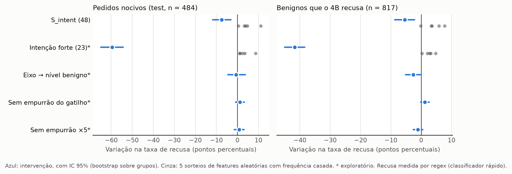

# C5: as features de intenção causam a recusa?

> Primeira leitura (2026-11-21), com o **classificador rápido de recusa (regex)**. O número final depende da rotulagem das respostas pelo juiz da frente A (pedido em `results/frente-a/PEDIDOS.md`). Gerado por `python -m featgrpo.interp.intervene` (`eixo`, `gerar`, `resumo`). Números em `c5_ablacao.json`; configuração, listas, sha256 e sorteios em `c5_config.json`; figura em `fig_c5_ablacao.png`.

## Em resumo

1. **Desligar as 48 S_intent reduz a recusa a pedidos nocivos.** São −7,4 pontos (IC 95% de −11,8 a −3,1). Desligar 48 features aleatórias com a mesma frequência de ativação **não reduz**: os 5 sorteios ficam entre +0,4 e +11,2 pontos. Contra a média dos sorteios, a diferença é de **−12,2 pontos** (IC de −16,0 a −8,4). **O C5 pré-registrado atende** nesta leitura.
2. **O efeito é igual com e sem gatilho:** −8,3 em `harm_trig` e −6,6 em `harm_notrig`. É o esperado de features que, pelo C1, não dependem da palavra.
3. **Desligar as S_intent também reduz o over-refusal.** Nos 817 pedidos benignos que o 4B recusa, a queda é de −5,4 pontos (IC de −8,7 a −2,2); as aleatórias dão de −0,1 a +7,7.
4. **Não há efeito colateral nos benignos comuns.** Nas células `ben_trig` e `ben_notrig`, a recusa já é ~0% e continua ~0% em todas as condições.
5. **O lado "S_lex" do C5 não pode ser testado:** a lista saiu vazia (frente C). O substituto exploratório, tirar o empurrão do gatilho no eixo da intenção, **não muda nada**, nem multiplicado por 5.
6. **As 23 features de "intenção forte" (exploratório) controlam o jeito de recusar.** Desligá-las leva a recusa pela regex a ~0%, nos nocivos e nos benignos recusados. Mas, lendo as respostas, o modelo continua desaconselhando boa parte dos pedidos; só deixa de dizer "I cannot…". Em outra parte, passa a entregar conteúdo. Quanto ele passa a atender de fato só o juiz vai dizer.

**Leitura:** a ablação mostra que as S_intent são **causalmente específicas**: mexer nelas muda a decisão de recusar, e mexer em features quaisquer não muda. Isso complementa o C2. Lá, features aleatórias **classificam** a intenção tão bem quanto as S_intent; aqui, só as S_intent **mudam o comportamento**.

## Desenho

**Intervenção.** Um hook na saída do bloco 29 (`resid_post`, `hidden_states[30]`). Ele age em todos os tokens: pedido, template e geração.

| Condição | O que faz | Status |
|---|---|---|
| `base` | Nada | referência |
| `s_intent` | Zera as 48 S_intent (L29 · `post_last`, 16k) | **pré-registrado** |
| `rand_s_intent_0…4` | Zera 48 features aleatórias, com frequência de ativação casada por decil (fora das listas da frente C) | controle |
| `forte` | Zera as 23 features de intenção forte fora de S_intent (lista exploratória da frente C) | exploratório |
| `rand_forte_0…4` | Controle aleatório da lista acima | controle |
| `eixo_benigno` | Só no `post_last`: leva a projeção no eixo da intenção u ao nível médio dos benignos | exploratório |
| `sem_empurrao`, `_x5` | Só no `post_last`: subtrai c·u (e 5c·u), o empurrão médio do gatilho | exploratório (substitui S_lex) |

- **Ablação com o erro de reconstrução preservado:** x' = x − dec(f) + dec(f'). Na prática, subtrai só a contribuição das features escolhidas. Com a lista vazia, a saída do modelo é **bit a bit igual** (teste).
- **Eixo e empurrão:** são o mesmo cálculo da frente C (`feature_stats.diagnostico_lexical`), no denso do `cells2x2`, L29 · `post_last`, descoberta do conjunto principal (1.455 grupos):
  - u = média de I_g, normalizada;
  - c = média de L_g·u = 322, que é **2,46% do efeito de intenção** (a frente C deu ~2,5%).
  - As intervenções de eixo agem só no `post_last`, onde u e c foram medidos.
- **Itens:**
  - o `test` do conjunto principal (`qc_grammatical` ∧ `validator_pass`, 242 grupos × 4 células = 968);
  - os 817 benignos que o 4B recusa (`hard_benign_4b.jsonl`: mineração, OR-Bench-Hard, FalseReject, XSTest).
  - As listas foram escolhidas só na descoberta.
- **Geração:** gulosa, até 256 tokens, sem system prompt, padding à esquerda.
- **Recusa:** regex de frases explícitas de recusa ("I cannot…", "I'm unable to…", "cannot fulfill"…). Contra o juiz da frente A, nas 19.968 respostas naturais do 4B, ela tem **precisão de 0,78 e cobertura de 0,56**. O Gemma costuma abrir com "I understand you're…" e recusar depois, e às vezes redireciona de forma útil usando as mesmas frases.
- **Estatística:**
  - diferença de taxas, pareada por item, com IC 95% por bootstrap sobre grupos (2.000 reamostragens);
  - critério do C5: efeito da lista menos o efeito médio dos 5 sorteios, com o mesmo bootstrap.

## Resultados

Variação na taxa de recusa (regex), em pontos percentuais, contra `base`. Entre colchetes, o IC 95%.

| Condição | Nocivos (484) | `harm_trig` | `harm_notrig` | Benignos recusados (817) | `ben_trig` / `ben_notrig` |
|---|---|---|---|---|---|
| `base` (taxa) | 59,9% | 63,2% | 56,6% | 41,7% | 0,4% / 0,0% |
| **`s_intent`** | **−7,4** [−11,8; −3,1] | −8,3 | −6,6 | **−5,4** [−8,7; −2,2] | 0,0 / 0,0 |
| aleatórias (5 sorteios) | +0,4 a +11,2 | | | −0,1 a +7,7 | ≤ +0,4 |
| `s_intent` − média das aleatórias | **−12,2** [−16,0; −8,4] | −13,1 | −11,2 | −9,5 [−12,2; −6,9] | |
| `forte`* | −59,5 [−64,9; −54,3] | −62,4 | −56,6 | −41,7 [−45,0; −38,4] | −0,4 / 0,0 |
| aleatórias (5 sorteios) | +1,0 a +8,7 | | | +0,2 a +4,8 | ≤ +0,4 |
| `eixo_benigno`* | −0,6 [−4,6; +3,7] | −2,9 | +1,7 | −2,6 [−5,1; −0,1] | 0,0 / 0,0 |
| `sem_empurrao`* | +1,2 [−0,8; +3,3] | +2,5 | 0,0 | +1,2 [−0,1; +2,7] | 0,0 / 0,0 |
| `sem_empurrao_x5`* | +0,8 [−1,5; +3,1] | −0,4 | +2,1 | −1,1 [−2,6; +0,5] | 0,0 / 0,0 |

\* exploratório.

## Interpretação

**S_intent participa da decisão de recusar.** É o resultado pré-registrado e o principal. O efeito é modesto (cerca de 1/8 das recusas some) e só existe para as S_intent. As features aleatórias, se fazem alguma coisa, **aumentam** a recusa um pouco: tirar features quaisquer deixa o modelo mais "cauteloso".

Isso responde à ressalva do VEREDITO sobre o C2. Lá, features sorteadas classificam a intenção tão bem quanto as S_intent, então ser boa classificadora não é exclusividade delas. Aqui, a especificidade aparece no **efeito causal**: das 11 listas desligadas (S_intent e 10 sorteios), só as S_intent derrubam a recusa nos nocivos. Ainda é uma leitura pela regex.

**O over-refusal parece passar pelo mesmo caminho da recusa legítima.** As mesmas features que reduzem a recusa a pedidos nocivos reduzem a recusa a pedidos benignos que o 4B recusa, e na mesma proporção (−7,4 e −5,4 pontos). Também não apareceu um canal "da palavra" separado:
- não existe S_lex;
- tirar o empurrão do gatilho não muda a recusa, nem com 5×.

A leitura mais simples: quando o 4B recusa um pedido benigno, é porque o **classificou como nocivo** no mesmo eixo de intenção, e não porque um detector de palavras disparou a recusa por fora. A frente C mediu que o empurrão do gatilho é real, mas pequeno (2,5% em L29). Ele é pequeno demais para causar recusa sozinho, pelo menos quando aplicado só no `post_last` de L29.

**Um ponto só não basta.** Levar a projeção no eixo ao nível benigno, só no `post_last` de L29, quase não muda nada (−0,6 e −2,6 pontos). A decisão não está concentrada num único vetor tão tarde. A informação de intenção já está espalhada pelos tokens e camadas anteriores, que o resto do modelo continua lendo. Já a ablação das S_intent age em todos os tokens, e por isso tem efeito. O resultado nulo do `sem_empurrao` herda essa limitação: ele diz que o empurrão **nesse ponto** não causa recusa, não que o gatilho não pese em lugar nenhum.

**As features de "intenção forte" são, em boa parte, o formato da recusa.** Os rótulos do Neuronpedia já indicavam isso ("cannot fulfill requests", "refusal to provide", "I understand you're", "I pronoun"). Desligá-las faz o modelo trocar "I cannot and will not…" por "this is a problematic request…" ou ir direto ao conteúdo. A regex deixa de ver a recusa. A pergunta que importa, se o modelo **passa a atender** pedidos nocivos, só o juiz responde. É também o resultado de uso duplo mais claro do projeto (ver "Uso responsável" no paper): no texto, só números agregados.

## Limitações

- **A recusa vem de uma regex** com cobertura de 0,56. Diferenças pequenas podem mudar com o juiz. A direção dos efeitos grandes, não.
- **Uma camada (L29) e um SAE (16k).** Não testamos camadas anteriores, nem o 262k ou o SAE próprio na intervenção.
- **Geração gulosa,** diferente do comportamento natural da frente A (temperatura 0,7). As taxas de `base` não são comparáveis às do `hcr_orr_4b.json`; só as diferenças entre condições contam.
- **O 2×2 não tem over-refusal para medir:** a recusa em `ben_trig` é 0,4%. O over-refusal foi medido nos `hard_benign_4b`, que não são pares mínimos.
- **As gerações não vão para o git:** são 40 MB e incluem respostas em que o modelo passa a ajudar com pedidos nocivos. Ficam em `artifacts/c5/` e vão para a frente A pela pasta compartilhada.
